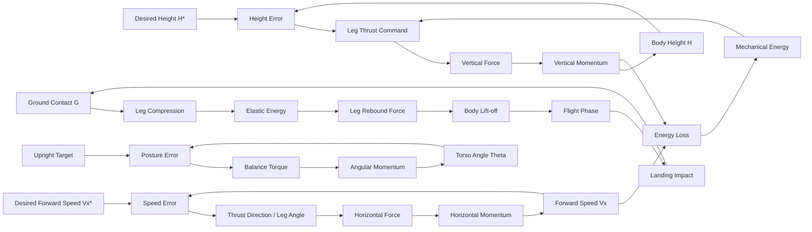

# 可学习系统动力学模型设计文档：Hopper Hop

**文档版本**：v1.0  
**日期**：2026-04-25  
**目标任务**：DeepMind Control Suite / `dm_control` 中的 Hopper `hop` 任务  
**设计目标**：用系统动力学（System Dynamics, SD）构建一个可解释、可学习、可验证的 Hopper Hop 核心动力机制模型。

---

## 0. 摘要

本文档提出一个 **Learnable System Dynamics for Hopper Hop** 的设计方案。

核心思想是：

> 将 Hopper Hop 抽象为一个由 **接触切换、腿部压缩、能量注入、姿态稳定、前向速度调节** 共同构成的非线性闭环系统；在此基础上，将 SD 中不可直接观测但具有解释意义的机制变量设计为 **潜在机制层**，并通过轨迹数据学习其参数、状态或函数关系。

该模型不是要逐关节精确复刻 MuJoCo，而是要构建一个兼具以下三点的灰箱模型：

1. **可解释**：保留 SD 的 stock-flow、feedback loop、能量流和因果结构。
2. **可学习**：将刚度、阻尼、控制延迟、损耗、反馈增益等设计为可学习对象。
3. **可验证**：用 Hopper 轨迹数据预测下一状态、reward、触地相位和跳跃周期稳定性。

---

## 1. 官方任务背景

`dm_control` 是 Google DeepMind 基于 MuJoCo 的物理仿真与强化学习环境集合，其中 `dm_control.suite` 提供一组由 MuJoCo 驱动的 Python 强化学习环境。官方仓库说明 `dm_control.suite` 是一组由 MuJoCo 物理引擎驱动的 Python RL environments[^dmcontrol_repo]。

Hopper 的官方 `hop` 任务在代码中定义为：

> “Returns a Hopper that strives to hop forward.”

即目标是让 Hopper 向前跳跃。官方 `hopper.py` 中还定义了：

- 控制时间步：`_CONTROL_TIMESTEP = 0.02`
- 默认 episode 时长：`_DEFAULT_TIME_LIMIT = 20`
- 站立高度阈值：`_STAND_HEIGHT = 0.6`
- 跳跃速度阈值：`_HOP_SPEED = 2`
- `hop` reward：`standing * hopping`

官方 observation 由三部分组成：

```python
obs['position'] = physics.data.qpos[1:].copy()  # 去掉水平位置以保持平移不变性
obs['velocity'] = physics.velocity()
obs['touch'] = physics.touch()
```

官方 `Physics` 中还给出了三个重要读数：

```python
height()  # torso 相对 foot 的高度
speed()   # Hopper 的水平速度
touch()   # toe 和 heel 两个足部触地传感器
```

Hopper 的 XML 模型为 planar hopper，包含：

- rootx/rootz/rooty 根自由度
- waist/hip/knee/ankle 关节
- toe/heel 两个 touch site
- torso_subtreelinvel 速度传感器
- waist/hip/knee/ankle 四个 motor actuator
- MuJoCo 内部 timestep：`0.005`

因此，本设计文档将 Hopper Hop 视作：

> 一个二维单腿机器人在地面接触和腾空阶段之间切换，通过腿部驱动和姿态控制形成稳定前向跳跃的动态系统。

---

## 2. 设计目标与非目标

### 2.1 设计目标

本模型的目标不是替代 MuJoCo，而是提供一个可解释的中层动态机制模型。

具体目标包括：

1. **解释 Hopper 为什么能跳起来**  
   通过腿部压缩、弹性储能、电机推力和地面反作用力解释跳跃生成。

2. **解释 Hopper 为什么能持续跳**  
   通过触地-腾空切换、能量损耗补偿和 limit cycle 形成机制解释周期性跳跃。

3. **解释 Hopper 为什么会摔倒**  
   通过姿态角、角动量、水平推力和姿态反馈不足解释失稳。

4. **将 SD 模型变成可学习模型**  
   用轨迹数据学习刚度、阻尼、损耗、控制延迟、接触门控、反馈增益和未知残差。

5. **形成可以用于实验的灰箱模型**  
   在保持因果结构可解释的同时，允许部分机制由小型可学习函数表示。

### 2.2 非目标

本设计暂不追求：

1. 逐刚体段精确复现 MuJoCo contact solver。
2. 逐 actuator 精确复现所有关节力矩。
3. 完全替代强化学习 policy。
4. 从像素输入端到端学习。
5. 严格处理三维动力学。Hopper 是 planar hopper，本设计采用二维近似。

---

## 3. 核心建模假设

### 3.1 Hopper 是一个受控弹簧腿系统

将 Hopper 抽象为：

```text
躯干质量块 + 可压缩单腿 + 足部接触 + 姿态控制 + 前向速度控制
```

这不是对 XML 几何的完整复刻，而是一个解释性 reduced-order model。

### 3.2 跳跃来自接触阶段的能量注入

Hopper 的核心动力循环是：

```text
触地 → 腿部压缩 → 弹性储能 + 电机主动施力 → 身体上升并前进 → 腾空 → 重力回落 → 再触地
```

### 3.3 持续跳跃是一个稳定极限环

成功的 Hopper Hop 策略不是单次跳跃，而是将系统带入一个稳定周期轨道：

```text
stance phase → flight phase → stance phase → flight phase → ...
```

### 3.4 可解释机制变量可以成为潜在机制层

SD 中用于解释的变量，例如：

- 等效腿部推力
- 弹性储能
- 能量损耗
- 接触相位
- 电机激活
- 姿态修正力矩

在可学习 SD 中不必全部直接观测。它们可以被设计为：

1. 可学习参数控制的中间变量；
2. 随时间演化的潜在状态；
3. 小型可学习函数输出的机制量。

---

## 4. 系统边界

### 4.1 纳入模型的内容

| 模块 | 说明 |
|---|---|
| 平动动力学 | 水平位置、水平速度、垂直高度、垂直速度 |
| 姿态动力学 | 躯干角、角速度、姿态恢复力矩 |
| 接触动力学 | toe/heel 触地、stance/flight 相位 |
| 腿部机制 | 腿部压缩、伸展、等效弹簧阻尼 |
| 主动控制 | 电机激活、推力方向、反馈增益 |
| 能量机制 | 能量注入、阻尼损耗、冲击损耗 |
| 任务目标 | standing、hopping、reward |

### 4.2 不纳入或仅作为残差处理的内容

| 模块 | 处理方式 |
|---|---|
| MuJoCo contact solver 细节 | 用接触门控与冲击损耗近似 |
| 多刚体精确惯量耦合 | 用等效质量、等效转动惯量近似 |
| 全部关节耦合非线性 | 用聚合腿部压缩和残差函数吸收 |
| 神经网络 policy 内部结构 | 作为外生动作输入或可学习反馈模块处理 |
| 视觉输入 | 不纳入当前版本 |

---

## 5. 变量分层设计

可学习 SD 模型中的变量分为四层：

1. **Observed State Layer**：直接观测变量。
2. **Derived Variable Layer**：由观测变量计算得到。
3. **Latent Mechanism Layer**：不可直接观测，但具有解释意义的机制变量。
4. **Learnable Parameter / Function Layer**：跨时间稳定或缓慢变化的可学习参数与函数。

---

## 6. 观测状态层：Observed State Layer

令观测状态为：

```math
x_t = [H_t, V_{x,t}, V_{z,t}, \Theta_t, \Omega_t, q_t, \dot q_t, touch_t]
```

其中：

| 变量 | 含义 | 来源 | 是否默认可观测 |
|---|---|---|---|
| `H_t` | torso 相对 foot 的高度 | `physics.height()` 或 qpos/body position | 是 |
| `Vx_t` | 水平速度 | `physics.speed()` 或 qvel | 是 |
| `Vz_t` | 垂直速度 | qvel / `physics.velocity()` | 是 |
| `Theta_t` | 躯干俯仰角 | rooty | 是 |
| `Omega_t` | 躯干角速度 | rooty velocity | 是 |
| `q_t` | 关节角 | qpos[1:] 中的 joint positions | 是 |
| `qdot_t` | 关节角速度 | qvel | 是 |
| `touch_t` | toe/heel 触地信号 | `physics.touch()` | 是 |
| `X_t` | 绝对水平位置 | qpos[0] | 默认 observation 不给，但 simulator 可读 |

注意：官方 observation 刻意去掉水平位置 `qpos[0]`，以保持平移不变性。因此，如果建模目标是复现 agent 可见状态，应排除 `X_t`；如果目标是解释轨迹与位移，则可以从 simulator 读取或由 `Vx_t` 积分得到。

---

## 7. 派生变量层：Derived Variable Layer

派生变量不是独立观测，但可以由观测状态计算得到。

| 变量 | 定义 | 说明 |
|---|---|---|
| `P_x,t` | `m * Vx_t` | 水平动量 |
| `P_z,t` | `m * Vz_t` | 垂直动量 |
| `L_theta,t` | `I * Omega_t` | 躯干角动量，需等效转动惯量 |
| `G_t` | `soft_contact(touch_t)` | 连续触地门控，范围 `[0, 1]` |
| `C_leg,t` | `L0 - L_hip_foot,t` | 腿部压缩 |
| `dC_leg,t` | `(C_leg,t - C_leg,t-1) / dt` | 腿部压缩速度 |
| `height_error_t` | `H* - H_t` | 高度误差 |
| `speed_error_t` | `Vx* - Vx_t` | 前向速度误差 |
| `posture_error_t` | `0 - Theta_t` | 姿态误差 |

### 7.1 腿部压缩推荐定义

推荐使用几何定义：

```math
C_{leg,t} = L_0 - L_{hip-foot,t}
```

其中：

- `L0` 是参考腿长，可取站立或初始状态下的 hip-foot 距离；
- `L_hip-foot,t` 可由 hip site 与 foot/toe/heel site 的坐标计算；
- 若无法直接读取 site 坐标，也可用 hip/knee/ankle 角度近似。

### 7.2 接触门控推荐定义

将 toe/heel touch 信号合成为连续触地变量：

```math
G_t = \sigma(k_g \cdot (\max(touch_{toe,t}, touch_{heel,t}) - \tau_g))
```

其中：

- `G_t ≈ 1`：stance phase；
- `G_t ≈ 0`：flight phase；
- `k_g` 和 `tau_g` 可以学习。

---

## 8. 潜在机制层：Latent Mechanism Layer

潜在机制变量是本设计中最重要的一层。它们不一定直接可观测，但负责承载 SD 的解释机制。

令潜在机制状态为：

```math
z_t = [A_t, E_t, G_t, C_{leg,t}, Loss_t, F_{leg,t}, \tau_{bal,t}]
```

| 变量 | 身份 | 是否随时间变化 | 是否可学习 | 解释意义 |
|---|---|---:|---:|---|
| `A_t` | 电机激活状态 | 是 | 是 | 动作到实际推力之间的延迟 |
| `E_t` | 机械能状态 | 是 | 可计算或学习 | 系统能量水平 |
| `G_t` | 接触相位 | 是 | 可学习门控 | stance/flight 切换 |
| `C_leg,t` | 腿部压缩 | 是 | 可计算或学习 | 弹簧腿状态 |
| `Loss_t` | 能量损耗 | 是 | 是 | 阻尼、冲击、摩擦损耗 |
| `F_leg,t` | 等效腿部推力 | 是 | 由参数/函数生成 | 跳跃主驱动力 |
| `tau_bal,t` | 姿态恢复力矩 | 是 | 是 | 防摔倒机制 |

重要说明：

> 潜在机制变量不等于参数。它们是随时间变化的中间机制量；参数控制这些机制量如何产生、如何相互作用、如何影响下一状态。

---

## 9. 可学习参数与函数层

### 9.1 可学习参数

| 参数 | 含义 | 约束 |
|---|---|---|
| `m` | 等效质量 | `m > 0`，也可固定 |
| `I` | 等效转动惯量 | `I > 0`，也可固定 |
| `k_leg` | 等效腿部刚度 | `k_leg > 0` |
| `b_leg` | 等效腿部阻尼 | `b_leg > 0` |
| `F_max` | 最大主动腿部推力 | `F_max > 0` |
| `tau_a` | 电机激活时间常数 | `tau_a > 0` |
| `d_x` | 水平阻尼系数 | `d_x >= 0` |
| `d_z` | 垂直阻尼系数 | `d_z >= 0` |
| `d_theta` | 角阻尼系数 | `d_theta >= 0` |
| `lambda_impact` | 冲击损耗系数 | `lambda_impact >= 0` |
| `K_h` | 高度反馈增益 | 可正可受限 |
| `K_v` | 速度反馈增益 | 可正可受限 |
| `K_theta` | 姿态角反馈增益 | 通常 `K_theta > 0` |
| `K_omega` | 角速度反馈增益 | 通常 `K_omega > 0` |
| `k_g` | 接触门控陡峭度 | `k_g > 0` |
| `tau_g` | 接触门控阈值 | 合理范围内 |

### 9.2 可学习函数

对于难以手写的关系，可以使用小型神经网络或可微函数：

| 函数 | 输入 | 输出 | 解释 |
|---|---|---|---|
| `f_contact_phi` | touch, H, Vz | `G_t` | 软接触相位 |
| `f_force_phi` | C_leg, dC_leg, A, G | `F_leg` | 等效腿部推力 |
| `f_loss_phi` | Vx, Vz, G, C_leg | `Loss_t` | 能量损耗 |
| `f_residual_phi` | x, z, u | 状态残差 | 吸收 reduced-order model 误差 |

建议优先使用 **结构化公式 + 少量残差函数**，不要一开始就把所有机制交给黑箱网络。

---

## 10. 核心因果回路

### 10.1 高度稳定负反馈 B1

```text
Body Height 低于目标
→ Height Error 增大
→ Leg Thrust Command 增大
→ Vertical Force 增大
→ Vertical Momentum 增大
→ Body Height 上升
→ Height Error 降低
```

### 10.2 前向速度负反馈 B2

```text
Forward Speed 低于目标
→ Speed Error 增大
→ 推力方向或主动推力增大
→ Horizontal Force 增大
→ Horizontal Momentum 增大
→ Forward Speed 上升
→ Speed Error 降低
```

### 10.3 姿态稳定负反馈 B3

```text
Torso Angle 偏离竖直
→ Posture Error 增大
→ Balance Torque 增大
→ Angular Momentum 被修正
→ Torso Angle 回到竖直附近
→ Posture Error 降低
```

### 10.4 跳跃节律形成回路 R1

```text
Ground Contact
→ Leg Compression
→ Elastic Energy
→ Leg Rebound + Motor Injection
→ Body Lift-off
→ Flight Phase
→ Gravity Pull-down
→ Landing Contact
→ Ground Contact
```

这是一个由接触切换、重力、弹性储能和主动能量补偿共同形成的振荡机制。

### 10.5 能量损耗约束回路 B4

```text
Jump Amplitude / Speed 增大
→ Damping + Impact Loss 增大
→ Available Mechanical Energy 降低
→ 下一跳高度和速度降低
```

---

## 11. Causal Loop Diagram



---

## 12. Stock-Flow 结构

### 12.1 Stocks

| Stock | 流入/流出 | 含义 |
|---|---|---|
| `X_t` | `Vx_t` | 水平位置 |
| `H_t` | `Vz_t` | 躯干高度 |
| `P_x,t` | `F_x - drag_x` | 水平动量 |
| `P_z,t` | `F_z - mg - drag_z` | 垂直动量 |
| `Theta_t` | `Omega_t` | 躯干角度 |
| `L_theta,t` | `tau_balance + tau_contact - damping` | 角动量 |
| `A_t` | activation adjustment | 电机激活 |
| `E_t` | energy injection - energy loss | 机械能 |

### 12.2 Flows

| Flow | 方程近似 | 解释 |
|---|---|---|
| Horizontal Movement | `dX/dt = Vx` | 前向运动 |
| Vertical Movement | `dH/dt = Vz` | 高度变化 |
| Horizontal Momentum Change | `dPx/dt = Fx - d_x Vx` | 水平推力与阻尼 |
| Vertical Momentum Change | `dPz/dt = Fz - mg - d_z Vz` | 垂直推力、重力、阻尼 |
| Angular Momentum Change | `dL/dt = tau_bal + tau_contact - d_theta Omega` | 姿态变化 |
| Activation Change | `dA/dt = (A_desired - A) / tau_a` | 电机响应延迟 |
| Energy Change | `dE/dt = Power_in - Loss` | 能量平衡 |

---

## 13. 动态方程设计

### 13.1 基本状态关系

```math
V_{x,t} = \frac{P_{x,t}}{m}
```

```math
V_{z,t} = \frac{P_{z,t}}{m}
```

```math
\Omega_t = \frac{L_{\theta,t}}{I}
```

```math
\dot X_t = V_{x,t}
```

```math
\dot H_t = V_{z,t}
```

```math
\dot \Theta_t = \Omega_t
```

### 13.2 软接触门控

```math
G_t = \sigma(k_g \cdot (\max(touch_{toe,t}, touch_{heel,t}) - \tau_g))
```

或更一般地：

```math
G_t = f_{contact,\phi}(touch_t, H_t, V_{z,t})
```

约束：

```math
0 \leq G_t \leq 1
```

### 13.3 电机激活动态

动作输入：

```math
u_t = action_t
```

聚合期望激活：

```math
A^{desired}_t = sat(W_u u_t + K_h(H^* - H_t) + K_v(V_x^* - V_{x,t}) - K_z V_{z,t} - K_{\theta}\Theta_t - K_{\omega}\Omega_t)
```

激活状态更新：

```math
A_{t+1} = A_t + \Delta t \cdot \frac{A^{desired}_t - A_t}{\tau_a}
```

约束：

```math
0 \leq A_t \leq 1
```

### 13.4 腿部推力

结构化版本：

```math
F_{leg,t} = G_t \cdot \max(0, k_{leg}C_{leg,t} - b_{leg}\dot C_{leg,t} + F_{max}A_t)
```

可学习函数版本：

```math
F_{leg,t} = G_t \cdot softplus(f_{force,\phi}(C_{leg,t}, \dot C_{leg,t}, A_t, u_t))
```

建议从结构化版本开始，再添加 residual。

### 13.5 推力方向分解

设腿部等效推力方向相对竖直方向的夹角为 `alpha_t`：

```math
F_{x,t} = F_{leg,t}\sin(\alpha_t)
```

```math
F_{z,t} = F_{leg,t}\cos(\alpha_t)
```

`alpha_t` 可以由几何计算，也可以由简化反馈控制给出：

```math
\alpha_t = sat_\alpha(K_{\alpha v}(V_x^* - V_{x,t}) + K_{\alpha \theta}\Theta_t)
```

### 13.6 平动更新

```math
\dot P_{x,t} = F_{x,t} - d_x V_{x,t}
```

```math
\dot P_{z,t} = F_{z,t} - mg - d_z V_{z,t}
```

离散化：

```math
P_{x,t+1} = P_{x,t} + \Delta t (F_{x,t} - d_x V_{x,t})
```

```math
P_{z,t+1} = P_{z,t} + \Delta t (F_{z,t} - mg - d_z V_{z,t})
```

```math
X_{t+1} = X_t + \Delta t V_{x,t}
```

```math
H_{t+1} = H_t + \Delta t V_{z,t}
```

### 13.7 姿态更新

```math
\tau_{bal,t} = K_{\theta}(0 - \Theta_t) + K_{\omega}(0 - \Omega_t)
```

接触引起的附加力矩：

```math
\tau_{contact,t} = r_{contact,t} \times F_{leg,t}
```

简化更新：

```math
\dot L_{\theta,t} = \tau_{bal,t} + \tau_{contact,t} - d_{\theta}\Omega_t
```

```math
L_{\theta,t+1} = L_{\theta,t} + \Delta t (\tau_{bal,t} + \tau_{contact,t} - d_{\theta}\Omega_t)
```

```math
\Theta_{t+1} = \Theta_t + \Delta t \Omega_t
```

### 13.8 能量平衡

机械能可近似为：

```math
E_t = \frac{1}{2}m(V_{x,t}^2 + V_{z,t}^2) + mgH_t + \frac{1}{2}I\Omega_t^2 + \frac{1}{2}k_{leg}C_{leg,t}^2
```

能量注入：

```math
Power_{in,t} = F_{motor,t} \cdot V_{extension,t}
```

能量损耗：

```math
Loss_t = d_xV_{x,t}^2 + d_zV_{z,t}^2 + d_{\theta}\Omega_t^2 + \lambda_{impact}G_t\max(0, -V_{z,t})^2
```

或：

```math
Loss_t = softplus(f_{loss,\phi}(V_{x,t}, V_{z,t}, \Omega_t, G_t, C_{leg,t}))
```

能量更新：

```math
E_{t+1} = E_t + \Delta t(Power_{in,t} - Loss_t)
```

约束：

```math
Loss_t \geq 0
```

---

## 14. Reward 建模

官方 hop reward 可以表达为：

```math
Reward_t = Standing(H_t) \cdot Hopping(V_{x,t})
```

其中：

```math
Standing(H_t) = tolerance(H_t; H_t \geq 0.6)
```

```math
Hopping(V_{x,t}) = tolerance(V_{x,t}; V_{x,t} \geq 2)
```

设计解释：

```text
只快但站不住 → reward 低
只站住但不前进 → reward 低
既有足够高度又有足够前向速度 → reward 高
```

在学习模型中，reward 可以作为额外监督信号：

```math
\mathcal{L}_{reward} = \sum_t \|\hat R_t - R_t\|^2
```

---

## 15. 可学习 SD 模型整体形式

### 15.1 状态、输入与潜变量

观测状态：

```math
x_t = [H_t, V_{x,t}, V_{z,t}, \Theta_t, \Omega_t, q_t, \dot q_t, touch_t]
```

动作输入：

```math
u_t = action_t
```

潜在机制状态：

```math
z_t = [A_t, E_t, G_t, C_{leg,t}, Loss_t]
```

可学习参数：

```math
\theta = [k_{leg}, b_{leg}, F_{max}, \tau_a, d_x, d_z, d_\theta, \lambda_{impact}, K_h, K_v, K_\theta, K_\omega, k_g, \tau_g]
```

### 15.2 灰箱动态

推荐形式：

```math
\dot x_t = f_{SD}(x_t, z_t, u_t; \theta) + f_{residual,\phi}(x_t, z_t, u_t)
```

```math
z_{t+1} = z_t + \Delta t \cdot h_{SD}(x_t, z_t, u_t; \theta, \phi)
```

```math
\hat x_{t+1} = x_t + \Delta t \cdot \dot x_t
```

其中：

- `f_SD`：可解释 SD / 物理结构。
- `h_SD`：潜在机制层更新。
- `f_residual_phi`：小型残差网络，用于补偿 reduced-order 偏差。

---

## 16. 训练目标

总损失函数建议为：

```math
\mathcal{L} =
\lambda_x\mathcal{L}_{state}
+ \lambda_R\mathcal{L}_{reward}
+ \lambda_E\mathcal{L}_{energy}
+ \lambda_C\mathcal{L}_{constraint}
+ \lambda_S\mathcal{L}_{smooth}
+ \lambda_P\mathcal{L}_{phase}
```

### 16.1 状态预测损失

```math
\mathcal{L}_{state} = \sum_t \|\hat x_{t+1} - x_{t+1}\|_2^2
```

可按变量尺度加权：

```math
\mathcal{L}_{state} = \sum_t \sum_i w_i(\hat x_{i,t+1} - x_{i,t+1})^2
```

### 16.2 Reward 预测损失

```math
\mathcal{L}_{reward} = \sum_t (\hat R_t - R_t)^2
```

### 16.3 能量一致性损失

```math
\mathcal{L}_{energy} = \sum_t \left(E_{t+1} - E_t - \Delta t(Power_{in,t} - Loss_t)\right)^2
```

### 16.4 约束损失

包括：

```math
k_{leg} > 0,\quad b_{leg} > 0,\quad F_{max} > 0,\quad \tau_a > 0
```

```math
0 \leq G_t \leq 1,\quad 0 \leq A_t \leq 1,\quad Loss_t \geq 0
```

可以通过参数化自动满足：

```math
k_{leg} = softplus(\tilde k_{leg})
```

```math
Loss_t = softplus(\tilde Loss_t)
```

```math
G_t = sigmoid(\tilde G_t)
```

### 16.5 平滑损失

避免潜在机制变量高频抖动：

```math
\mathcal{L}_{smooth} = \sum_t \|z_{t+1} - z_t\|^2
```

或对激活、接触相位单独约束：

```math
\sum_t (A_{t+1} - A_t)^2 + \sum_t (G_{t+1} - G_t)^2
```

### 16.6 相位一致性损失

如果使用 touch sensor 作为 weak label：

```math
\mathcal{L}_{phase} = \sum_t BCE(G_t, \mathbf{1}[touch_t > \tau])
```

---

## 17. 可辨识性问题与约束策略

### 17.1 刚度与主动推力混淆

问题：

```math
F_{leg} = kC_{leg} + F_{max}A_t
```

同样的 `F_leg` 可以由较大的刚度或较大的主动推力解释。

解决策略：

- 固定或限制 `F_max` 的范围；
- 使用动作 `u_t` 与 `A_t` 的时间相关性约束；
- 给 `k_leg` 加先验范围；
- 用触地初期和蹬伸期分别识别被动弹性与主动推力。

### 17.2 阻尼损耗与冲击损耗混淆

问题：落地后速度下降既可能来自连续阻尼，也可能来自瞬时冲击损耗。

解决策略：

- 将 `lambda_impact` 只允许在 `G_t` 上升边沿附近发挥作用；
- 对连续阻尼使用全时段平方速度损耗；
- 对冲击损耗使用落地相位门控。

### 17.3 姿态控制与推力方向混淆

问题：torso 角度恢复可能来自 balance torque，也可能来自腿部推力方向变化。

解决策略：

- 将 `tau_bal` 与 `Theta/Omega` 显式绑定；
- 将 `alpha_t` 与速度误差、腿部几何绑定；
- 对两者分别加结构约束。

### 17.4 残差网络吞噬解释结构

问题：如果 residual network 太强，模型会忽略 SD 结构。

解决策略：

- 限制 residual 维度和幅度；
- 增加 `||f_residual||^2` 惩罚；
- 先训练无 residual 版本，再打开 residual fine-tune；
- 报告 residual 占总预测量的比例。

---

## 18. 数据采集与日志 schema

每个时间步建议记录：

```text
episode_id
step_id
time
qpos
qvel
action
reward
discount
position_observation
velocity_observation
touch_observation
height
speed
torso_angle
torso_angular_velocity
toe_touch
heel_touch
optional_body_positions
optional_site_positions
optional_actuator_forces
optional_contact_forces
```

### 18.1 最小日志字段

如果只能记录 agent observation 和 action，至少需要：

```text
H_t
Vx_t
Vz_t
Theta_t
Omega_t
joint_angles_t
joint_velocities_t
touch_toe_t
touch_heel_t
action_t
reward_t
```

### 18.2 推荐额外字段

如果可以访问 MuJoCo `physics` 内部状态，建议增加：

```text
qpos[0] absolute X
body world positions
site world positions
actuator forces
contact forces
body masses
body inertia
```

这些字段能显著提升腿部压缩、推力、能量和接触损耗的可辨识性。

---

## 19. 训练流程

### 19.1 阶段一：无残差结构化学习

目标：学习可解释参数，验证 SD 结构是否能基本预测 Hopper 动态。

```text
输入：trajectory: (x_t, u_t, x_{t+1}, r_t)
模型：纯 SD 方程
输出：theta, z_t
损失：state + reward + constraints + smoothness
```

### 19.2 阶段二：加入潜在机制平滑与相位约束

目标：让 `A_t`, `G_t`, `Loss_t`, `E_t` 具有稳定解释意义。

```text
加入：phase loss, energy loss, latent smoothness loss
观察：G_t 是否对齐 stance/flight；E_t 是否随跳跃周期合理变化
```

### 19.3 阶段三：加入小残差网络

目标：补偿 reduced-order model 的误差，但不破坏解释性。

```text
f_total = f_SD + f_residual
约束 residual magnitude
比较有无 residual 的预测提升
```

### 19.4 阶段四：rollout 验证

目标：评估模型是否能多步预测稳定跳跃周期。

```text
1-step prediction
5-step rollout
20-step rollout
full episode rollout
phase reconstruction
reward reconstruction
failure mode prediction
```

---

## 20. 伪代码

```python
for batch in trajectory_loader:
    x_t, u_t, x_next, r_t = batch

    # 1. derive variables
    C_leg = compute_leg_compression(x_t)
    dC_leg = finite_difference(C_leg)
    G = contact_gate(x_t.touch, params.k_g, params.tau_g)

    # 2. latent mechanism update
    A_desired = activation_command(x_t, u_t, params)
    A_next = A + dt * (A_desired - A) / params.tau_a

    # 3. force generation
    F_leg = G * relu(params.k_leg * C_leg
                     - params.b_leg * dC_leg
                     + params.F_max * A)

    alpha = thrust_angle(x_t, params)
    Fx = F_leg * sin(alpha)
    Fz = F_leg * cos(alpha)

    # 4. SD state update
    Px_next = Px + dt * (Fx - params.d_x * Vx)
    Pz_next = Pz + dt * (Fz - m * g - params.d_z * Vz)
    L_next = L + dt * (tau_balance(x_t, params)
                       + tau_contact(F_leg, x_t)
                       - params.d_theta * Omega)

    x_hat_next = reconstruct_state(Px_next, Pz_next, L_next, x_t)

    # 5. optional residual correction
    x_hat_next = x_hat_next + residual_net(x_t, u_t, latent_z)

    # 6. reward and losses
    r_hat = hopper_reward(x_hat_next)
    loss = state_loss(x_hat_next, x_next) \
         + reward_loss(r_hat, r_t) \
         + energy_consistency_loss(...) \
         + constraint_loss(params, latent_z) \
         + smoothness_loss(latent_z)

    loss.backward()
    optimizer.step()
```

---

## 21. 模型输出与解释接口

训练完成后，模型应能输出以下解释结果。

### 21.1 每个时间步的机制分解

```text
height error
speed error
posture error
contact phase G
leg compression C_leg
motor activation A
leg thrust F_leg
horizontal force Fx
vertical force Fz
energy injection
energy loss
balance torque
predicted reward
```

### 21.2 每个 episode 的行为解释

```text
是否形成稳定 limit cycle
stance/flight 占比
每跳平均能量注入
每跳平均能量损耗
reward 下降的主要原因
摔倒前姿态误差如何扩大
速度不足是推力不足还是接触相位错误导致
```

### 21.3 失败模式诊断

| 失败模式 | 可解释信号 |
|---|---|
| 跳不起来 | `F_leg` 低、`A_t` 低、`C_leg` 不足 |
| 越跳越低 | `Loss_t > Power_in`，能量净流失 |
| 向前速度不足 | `Fx` 低、`alpha_t` 不合理、`K_v` 弱 |
| 前扑摔倒 | `Theta` 增大、`tau_bal` 不足、`Fx` 过强 |
| 后仰摔倒 | `Theta` 负向偏离、接触力矩方向错误 |
| 相位错乱 | `A_t` 峰值与 `G_t` 不对齐 |

---

## 22. 评估指标

### 22.1 预测指标

| 指标 | 说明 |
|---|---|
| 1-step MSE | 下一状态预测误差 |
| k-step rollout MSE | 多步滚动预测误差 |
| reward MSE | reward 重构误差 |
| phase accuracy | 触地/腾空相位准确率 |
| velocity correlation | 预测速度与真实速度相关性 |
| height correlation | 预测高度与真实高度相关性 |

### 22.2 机制指标

| 指标 | 说明 |
|---|---|
| Energy consistency error | 能量平衡残差 |
| Contact-force alignment | `F_leg` 是否主要在 stance phase 出现 |
| Activation-contact alignment | `A_t` 是否与触地蹬伸期对齐 |
| Residual ratio | residual 对总预测的贡献比例 |
| Parameter plausibility | 参数是否满足物理约束和合理范围 |

### 22.3 行为指标

| 指标 | 说明 |
|---|---|
| Cycle period error | 跳跃周期误差 |
| Stance duration error | 触地时长误差 |
| Flight duration error | 腾空时长误差 |
| Failure prediction lead time | 摔倒前提前识别能力 |
| Reward trend accuracy | reward 上升/下降趋势预测 |

---

## 23. 推荐实验设计

### 实验 A：仅用观测状态训练

目的：验证最小数据条件下模型是否可行。

```text
输入：official observation + action + reward
不使用：contact force, actuator force, body world positions
目标：学习可解释 reduced-order SD
```

预期：状态预测可用，但 `F_leg`、`Loss_t` 的辨识不够稳定。

### 实验 B：加入 MuJoCo 内部辅助数据

目的：增强机制变量可辨识性。

```text
加入：site positions, actuator forces, contact forces
目标：更准确学习 C_leg, F_leg, Loss_t
```

预期：机制解释更稳定，参数更容易收敛。

### 实验 C：有无残差网络对比

目的：评估灰箱残差的价值。

```text
Model 1: pure SD
Model 2: SD + small residual
Model 3: black-box dynamics network
```

比较：

```text
预测精度
rollout 稳定性
机制解释一致性
参数可解释性
```

### 实验 D：失稳案例解释

目的：验证模型是否不仅能解释成功跳跃，也能解释失败。

```text
采集不同策略阶段的 trajectories：
- early training: 摔倒多
- mid training: 偶尔跳跃
- trained policy: 稳定 hop
```

观察：

```text
energy balance
posture error growth
activation-contact alignment
speed-height tradeoff
```

---

## 24. 推荐最小可实现版本

如果要最快落地，建议实现 v0.1：

### 24.1 输入

```text
H, Vx, Vz, Theta, Omega, touch_toe, touch_heel, action, reward
```

### 24.2 潜变量

```text
G, A, C_leg, F_leg, Loss
```

### 24.3 可学习参数

```text
k_leg, b_leg, F_max, tau_a, d_x, d_z, d_theta, K_theta, K_omega, k_g, tau_g
```

### 24.4 方程

使用结构化版本：

```math
G_t = sigmoid(k_g(max(touch_t) - \tau_g))
```

```math
A_{t+1} = A_t + dt(A^{desired}_t - A_t)/\tau_a
```

```math
F_{leg,t} = G_t max(0, kC_t - b\dot C_t + F_{max}A_t)
```

```math
\dot P_x = F_x - d_xV_x
```

```math
\dot P_z = F_z - mg - d_zV_z
```

```math
\dot L = K_\theta(0-\Theta) + K_\omega(0-\Omega) - d_\theta\Omega
```

### 24.5 暂不加入

```text
residual network
contact force supervision
full energy consistency
multi-body inertia correction
```

v0.1 的目标不是最高精度，而是验证：

> 一个可学习 SD 结构能否重构 Hopper Hop 的主要跳跃周期、速度、高度和摔倒趋势。

---

## 25. 关键设计决策

### 决策 1：不把机制变量直接等同于参数

机制变量如 `F_leg,t`、`Loss_t`、`A_t` 是随时间变化的中间状态；参数如 `k_leg`、`b_leg`、`tau_a` 才是跨时间稳定的可学习对象。

### 决策 2：优先使用灰箱模型

不采用纯黑箱 latent dynamics，而采用：

```math
f = f_{SD} + f_{residual}
```

其中 `f_SD` 是主结构，`f_residual` 只补偿误差。

### 决策 3：接触相位必须显式建模

Hopper Hop 的核心不是普通连续动力学，而是 hybrid dynamics：

```text
stance phase 与 flight phase 的切换决定了能量注入时机。
```

因此 `G_t` 必须作为显式机制变量。

### 决策 4：能量平衡是解释稳定跳跃的核心

仅预测位置和速度不足以解释 Hopper 为什么能持续跳。模型应输出：

```text
Power_in, Loss, Energy Balance
```

### 决策 5：约束比模型容量更重要

如果没有物理约束，模型容易通过不可解释方式拟合轨迹。必须强制：

```text
刚度非负
阻尼非负
损耗非负
接触门控在 [0, 1]
激活在 [0, 1]
残差幅度受限
```

---

## 26. 风险与缓解

| 风险 | 表现 | 缓解 |
|---|---|---|
| 参数不可辨识 | 多组参数都能拟合轨迹 | 加先验、分阶段训练、使用辅助数据 |
| residual 过强 | 解释变量失去意义 | 限制 residual，先训 pure SD |
| 接触相位不稳定 | `G_t` 高频抖动 | 使用 touch weak label 与平滑约束 |
| 能量项不合理 | 出现负损耗或凭空增能 | `Loss = softplus(.)`，能量一致性损失 |
| 过度简化 | 多步 rollout 快速发散 | 加小残差、使用更细粒度状态 |
| reward 拟合但机制错误 | 只学到 reward proxy | 同时监督状态、相位、能量与机制一致性 |

---

## 27. 后续扩展方向

1. **Policy explanation**  
   将已训练 RL policy 的动作映射到 SD 机制变量，解释 policy 在何时注入能量、何时修正姿态。

2. **Counterfactual simulation**  
   修改 `k_leg`、`tau_a`、`d_z` 等参数，分析 Hopper 会如何失稳或改善。

3. **Transfer to other locomotion tasks**  
   将该框架扩展到 Walker、Cheetah、Humanoid。

4. **Causal discovery refinement**  
   在 SD 结构基础上学习哪些反馈边最重要。

5. **Controller synthesis**  
   用 learnable SD 模型设计更简单、可解释的控制器，而不是完全依赖黑箱 policy。

---

## 28. 一句话总结

Hopper Hop 的可学习 SD 模型可以被设计为：

> 一个以观测运动状态为输入、以接触相位和能量流为核心、以腿部推力和姿态反馈为主要机制、以可学习参数和潜在机制层为桥梁的灰箱动态模型。

最关键的设计原则是：

```text
观测变量用于约束现实；
机制变量用于解释行为；
可学习参数用于适配数据；
物理约束用于保护解释性。
```

---

## 参考资料

[^dmcontrol_repo]: Google DeepMind, `dm_control` repository, README: `dm_control` is infrastructure for physics-based simulation and reinforcement learning environments using MuJoCo. https://github.com/google-deepmind/dm_control

[^hopper_py]: Google DeepMind, `dm_control/dm_control/suite/hopper.py`. The file defines `_CONTROL_TIMESTEP = .02`, `_STAND_HEIGHT = 0.6`, `_HOP_SPEED = 2`, `hop()` as forward hopping, observation fields, `height()`, `speed()`, `touch()`, and reward `standing * hopping`. https://github.com/google-deepmind/dm_control/blob/main/dm_control/suite/hopper.py

[^hopper_xml]: Google DeepMind, `dm_control/dm_control/suite/hopper.xml`. The file defines the planar hopper model, joints, touch sites, sensors, actuators, and MuJoCo timestep. https://github.com/google-deepmind/dm_control/blob/main/dm_control/suite/hopper.xml

[^dmcontrol_paper]: Yuval Tassa et al., “DeepMind Control Suite”, arXiv:1801.00690. The paper describes the suite as a set of continuous control tasks with standardized structure and interpretable rewards, powered by MuJoCo. https://arxiv.org/abs/1801.00690
