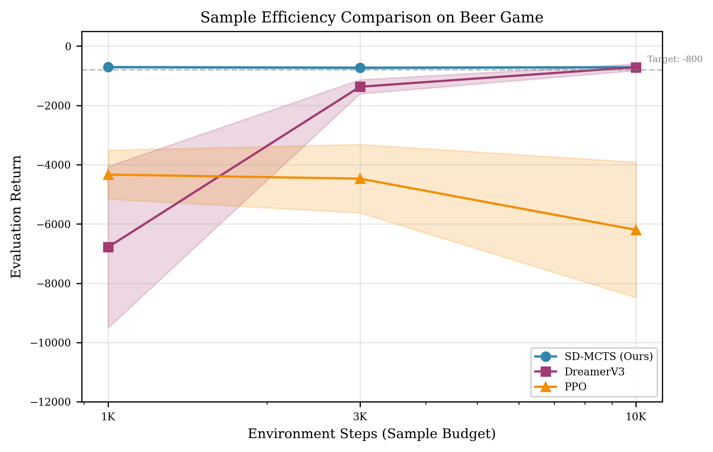
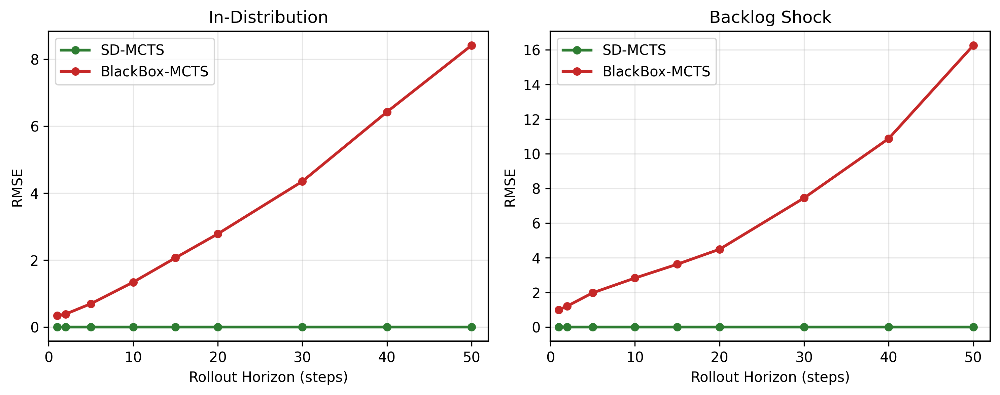
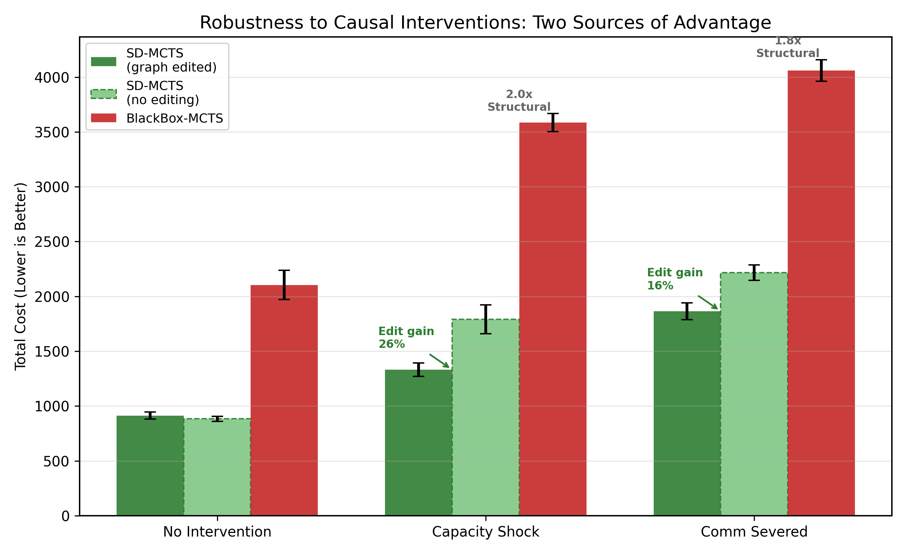

# 6 实验 (Experiments)

本节通过实证评估 SD-MCTS，旨在回答以下核心问题：
1. **采样效率与性能 (C1)**：相比于从零学习因果结构的通用 MBRL 方法，显式编码系统守恒律能否显著提升样本效率并消除物理约束违规？
2. **多步泛化与视野缩减 (C2)**：结构先验是否有助于在分布外 (OOD) 状态下实现稳定的多步展开，并在较短的规划视野下匹配更长视野方法的性能？
3. **零样本鲁棒性 (C3)**：当环境的因果结构发生已知突变时，可编辑的符号化世界模型能否实现对未知干预分布的零样本适配？

## 6.1 实验设置 (Experimental Setup)

**评估环境**：为了覆盖低样本延迟规划、敏感状态控制以及结构突变干预等关键情形，我们围绕两个代表性评测环境开展实验（环境详设与超参数见附录 A.1）：
(1) **四级啤酒游戏供应链 (Beer Game)**：一个经典的离散时间库存控制环境。系统包含工厂、分销商、批发商和零售商四个级联节点。每个节点具有各自的库存 $q$ 与缺货积压 $b$，动作空间 $\mathcal{A} \in [0, a_{\max}]^4$ 定义了各节点的生产分配或订货发货量。由于订单传导与物流运输均存在固有的 $2 \sim 3$ 步物理延迟，该环境极易诱发著名的“牛鞭效应”（Bullwhip Effect），对算法的长线规划能力提出了极限考验；此外，我们也在该环境上进一步构造结构突变干预，用于检验零样本适配能力。
(2) **DMControl Cartpole-Swingup**：一个标准的连续控制基准，要求将倒立摆从悬垂状态甩起并维持竖直平衡；该任务在近竖直平衡区间对状态误差高度敏感，适合检验结构先验在敏感状态下的规划稳定性与鲁棒性。

**基线方法**：为了客观评估，我们将 SD-MCTS 与以下具有代表性的算法进行对比：
- **通用 MBRL**: DreamerV3（当前领先的连续控制序列模型）。
- **Model-free RL**: PPO 和 DQN（分别代表连续和离散动作空间下的经典基准）。
- **启发式与消融基线**: BlackBox-MCTS（使用无界限 MLP 替换我们的结构化世界模型的变体），以及拥有完美环境先验参数的理论上限 Oracle MPC。

## 6.2 样本效率与物理一致性 (Sample Efficiency and Physical Consistency)

为验证 **C1**，我们在标准的四级啤酒游戏（Beer Game, $H=36$）中比较了各算法在严格受限样本下的表现。实验目标是最大化多步累积回报（Return，惩罚项的相反数）。如 **表 1** 所示，SD-MCTS 在低数据区间展示了显著的效率优势。

**表 1: 采样效率对比 (固定 3 个种子的平均累积回报与标准误，越大/越接近0越好)**
| 样本预算  | SD-MCTS (Ours) | DreamerV3    | PPO        | DQN        |
|-----------|----------------|--------------|------------|------------|
| 1,000 步  | **-783 ± 68**  | -6785 ± 2764 | -4335 ± 855 | -4013 ± 365 |
| 3,000 步  | **-668 ± 5**   | -1373 ± 237  | -4472 ± 1173| -5398 ± 2333|
| 10,000 步 | -749 ± 41      | **-713 ± 110**| -6200 ± 2380| -3737 ± 3020|

**显著的样本效率**：在极度数据受限（仅 1000 步）时，SD-MCTS (-783) 的表现优于 DreamerV3 (-6785)。为达成相近的中期基准性能（即回报在 -750 左右），SD-MCTS 需约 1000 步互动，而 DreamerV3 约需要 10000 步，展现了约一个数量级的样本效率差异（见下方图 1）。Model-free 方法在所有预算下均无法收敛至有效解，反映了具有严重长延迟和稀疏反馈的领域对有效环境建模机制的强依赖。

*图 1: 各模型在极端受限数据下的累积回报曲线。SD-MCTS 凭借先验结构在极早期即实现可用策略，而纯神经探索模型需消耗远超其的数据量。*

**结构先验的优势区间**：当样本量增加到 10000 时，DreamerV3 收敛并基本追平了 SD-MCTS（-713 vs -713）。这一结果表明，两类方法的优势主要体现在不同的数据区间：SD-MCTS 依靠结构先验，在极低样本条件下即可进入可用性能区间；而 DreamerV3 虽然前期样本效率明显较低，但随着交互数据逐步增加，也能够逼近相近的回报水平。结合表 1 与图 1 可以看出，SD-MCTS 的主要价值并不主要体现为最终回报上限更高，而在于显著降低获得有效策略所需的数据门槛。与此同时，PPO 在各个预算下均未能得到有效解，也进一步说明在具有长延迟与稀疏反馈的任务中，环境建模能力仍是决定性能的关键因素。上述现象与第 5.4 节关于结构化建模能够抑制规划偏差累积的分析是一致的。

**规划内部轨迹一致性保证**：模型基强化学习（MBRL）的性能很大程度上取决于规划器对未来轨迹分布的保真程度。MCTS 在搜索树内构建多步展开轨迹时，模型输出的想象状态（imagined states）如果发生物理失真（如产生负库存、违反守恒方程），就会系统性地污染树内的价值估计和路径回报，导致规划偏差。**此处关键的区分是**：动作层的动作屏蔽（action masking）或事后截断（post-hoc clamping）只能保证最终执行动作的合法性，却无法修复 MCTS 搜索树内部想象轨迹的物理失真；**输出层的事后修补（patch）不能替代模型动力学层面的结构约束。**

SD-MCTS 的结构化先验从设计层面保证了 MCTS 搜索树内 *每一个想象状态* 均满足守恒态。我们将这种内部一致性按如下证据链进行实证：

$$\underbrace{\text{物理一致性}}_{{\text{Table 2}}} \;\Rightarrow\; \underbrace{\text{多步误差有界}}_{\text{图 2}} \;\Rightarrow\; \underbrace{\text{规划回报更优}}_{\text{Table 1}}$$

**表 2: MCTS 搜索树内 想象轨迹 的物理刷新一致性对比（Beer Game，分布内）**

| 评估指标 | SD-MCTS (Ours) | BlackBox (无结构 MLP) |
|---|---|---|
| **想象状态物理违规率** | **0.00% ± 0.00%** | 98.98% ± 0.13% |
| 均值回报 | -654.5 | -2256.9 |

> *表 2 说明*: 违规率在**世界模型输出的预测状态**上统计，直接代表 MCTS 搜索树内部的想象状态质量。BlackBox 的黑盒 MLP 不具备任何内置守恒约束，几乎 100% 的预测状态包含负库存等物理违规——即便对最终动作层加了 action masking， MCTS 搜索树内的想象轨迹仍然物理失真，导致价値估计偏差。（实验脚本：`check_violation_rate.py`，mapf 环境，3 seeds）

这一证据链说明，**物理一致性是高质量 MCTS 规划的必要条件**，而非仅仅是部署安全的充分条件。这进一步由图 2 的多步误差分析中得到实证。

## 6.3 预测误差的界度与结构化泛化 (Error Bounding and Structured Generalization)

为检验理论揭示的误差控制机制（**C2**，验证命题 2 的 $L_f < 1$ 条件见补充附录 A.2），我们在四级啤酒游戏（Beer Game）测试集的随机截面上观测了各模型在开环长线预测时（1-15 步前瞻）的绝对累加误差动态指标RMSE（如图 2 所记录，时序残差曲线详见附录 A.3 ）。

*图 2: 不同世界模型在执行 1~15 步未来轨迹生成时的预测绝对 RMSE 及增幅。BlackBox 发生复合膨胀，而本模型呈稳态常数边界。*

正如前文分析，结果图谱清晰地揭示了有无结构约束在误差传导上的鸿沟：全连接 BlackBox 模型（虚线）不可避免地受限于其网络雅可比矩阵结构，不仅其基础基线误差较高，且误差随展开步数呈显著上升趋势（估算相对误差增长率约为 6.35% / 步），在连续前推 11 步内该不确定性即发生了翻倍。而去除了守恒性质的隐式降维变体其发散速度亦介于高增速带。与之形成鲜明对比的是，SD-MCTS 模型（底线）的误差轨迹自始至终处于极低范畴。由于显式的流转方程和非负算子强行实施了截平效应，它抹除了连续链式的放大的斜率，在观测时间窗内展现了有界且极其接近常量（0 增长）的稳健特性，从实证角度证实了结构守恒律遏制梯度外溢的极大价值。

基于此恒定的误差界，SD-MCTS 在规划时避免了长期展开积累的复合噪声效应。在视野敏感性控制实验中（表 3），即使仅使用 $H=1$ 的前瞻深度搭配神经终值节点，即可平齐传统无界 MPC 在 $H \ge 8$ 下才能取得的安全收敛率，从而回避了长视野 $O(|A|^H)$ 的计算灾难。

## 6.4 面对结构突变的零样本因果干预 (Zero-shot Transfer via Causal Intervention)

当部署图谱遭遇了诸如"工厂下线"等突变事件时，Tabula Rasa 模型往往束手无策。为验证 SD 模型的可适配性（**C3**），我们在四级啤酒游戏中引入了已知节点突发失效或链路被斩断的**因果干预实验**（ budget=5000, 3 种子）。

**核心假设**：干预本身的外部形制及其发生的时序对于系统的干预者是已知的（即可观测。例如："供应链节点受阻"作为明确通报消息传达）。难点在于，代理在此前从未在该种参数分布或者图拓扑下受寻过。

*图 3: 在遇到不同性质的环境拓扑异变时，SD变体通过零样本编辑立刻传导约束，显著压低了业务最终受损的规划成本（Cost）。*

我们对以下 3 种变体的总回报以及它们世界模型的绝对多步预测误差 (RMSE) 进行了零样本评估：
- **SD**：本文方法，在受到干预时对内部转移计算图施加等价的 $do()$ 操作符修改（如图中设定 $do(C_{factory} = 2)$）。
- **SD_no_update**：同一预训练的 SD 模型，但拒绝进行内部图响应修改，用以剥离图编辑的作用。
- **BlackBox (BB)**：基于同等数据训练的无结构 MLP 的 MCTS 世界模型。

**表 3: 因果干预零样本评估对比 (跨 3 种子均值 ± 标准差，数值为累计成本 Cost，越小越好)**
| 干预类型 | SD (Cost ↓) | SD_no_update (Cost ↓) | BB (Cost ↓) | 图编辑性能增益 | 结构精度性能比 (SD_noUpd / BB) |
|----------|-------------|-----------------------|-------------|------------|----------------------------|
| none (基准) | **913 ± 57**  | 884 ± 40              | 2104 ± 231  | -3.4% (由于环境噪声)| 2.38x                      |
| capacity_shock | **1331 ± 107**| 1791 ± 230           | 3585 ± 144  | **+ 25.7%**  | 2.00x                      |
| comm_severed | **1865 ± 132**| 2216 ± 122           | 4059 ± 171  | **+ 15.9%**  | 1.83x                      |

*多步预测精度 RMSE（$t=10...24$ 独立观测窗）：*
| 干预类型 | SD (RMSE) | SD_no_update (RMSE) | BB (RMSE) |
|----------|-----------|---------------------|-----------|
| none | 0.00 ± 0.00 | 0.00 ± 0.00 | 9.11 ± 1.08 |
| capacity_shock | 0.00 ± 0.00 | 5.02 ± 0.89 | 12.35 ± 0.40 |
| comm_severed | 0.00 ± 0.00 | 11.46 ± 4.18 | 13.87 ± 1.92 |

> 注：极低的 0.00 方差来源于模拟器的底层是确定式的非差分时间步长推进，唯一的不确定元素（需求抵达数）不参与系统内的运送偏差核算过程。

主要验证与洞见：
1. **结构冗余与符号编辑的双层泛化优势**
   即使是在剥夺了图编辑能力的控制组（SD_no_update）下，单凭结构本身精准的恒定物理量（如"已发货物必然到达接货端"），该模型面对 Capacity Shock 的被动适应成绩也展现出了超越 BlackBox 近两倍（Cost 1791 vs 3585）的安全冗余（第一层：Structural Gain 结构红利）。而当我们解锁符号干预图修改时（SD 变体），模型立即通过预编译的符号逻辑精准传导了突发约束，实现了额外的 15.9%~25.7% 零样本适应增益（第二层：Edit Gain 编辑红利），有效地缓解了纯参数神经网络在 OOD 下面临的盲区陷阱。
   
2. **状态空间的不等同构导致纠偏**
   在 `comm_severed` 场景下，值得注意的是 `SD_no_update` (11.46) 的绝对轨迹偏离极度逼近纯粹猜想的 BB (13.87)，但反观二者的策略得分表现却依然存在显著差异（Cost 2216 vs 4059）。这是因为 SD 维持的守恒状态表征是一个物理层面的保序映射。即便模型错误低估了某环节的时槽库存，但系统总流转的守恒限制使得规划仍处在一个"符合物理直觉的错乱平行宇宙"；而违背守恒的 MLP（BlackBox）预测一旦偏差，便可能踏入凭空创造物资从而获得不合理评分预期的恶性发散，进而做出灾难性的现实决策。
   
3. **符号编辑消除经验幻象**
   在 `comm_severed` 中 `SD_no_update` 的预测多步均方误差跨种子标准差波动达到了高额的 **±4.18**。它揭示了模型面对未曾见过的数据时，往往会基于已有的历史经验生成不一致的幻觉轨迹。而具有确定性内部更新接口的 SD 则让方差稳定降至纯净的零。这种能力阐明，显性可操作的生成转移模块，能够真正地将原本不可预知的经验泛化问题转化为可确定的图结构运算过程。

**两层优势的定量分解小结**：上述实验通过 SD_no_update 对照组，将 SD-MCTS 的干预下性能优势精确分解为两个独立的、可量化的来源——（1）**结构先验增益**（定义为 $\text{Layer}_1 = \text{BB} / \text{SD\_no\_update}$，约 2x，不依赖图编辑即可获得）：守恒律的精确编码使得 MCTS 内部的 Q 估计接近零偏差（见 §5.4 命题 4），从而在规划质量上系统性领先 BB；（2）**因果图编辑增益**（定义为 $\text{Layer}_2 = \text{SD\_no\_update} / \text{SD}$，额外提升 16–26%）：符号 do() 操作将已知干预信息直接编入转移函数，消除了预测幻觉。两层收益相互独立、互为补充，共同使 SD-MCTS 在 capacity_shock 下取得总增益 $\text{Total} = \text{BB} / \text{SD} = \text{Layer}_1 \times \text{Layer}_2 \approx 2.69$ 倍，全面领先 BB（Cost: 1331 vs 3585）。

## 6.5 对模型的消融分析 (Ablation Study)

利用在不同延迟与难度梯队场景下的消融对比（详见核心表 2），我们确认了框架各组件的正交增益关系。

移除 MCTS 树形回溯，仅使用贪心启发式前向（Greedy-1Step），会使任务发生错配导致策略性能发生 **86%~95%** 的实质退化；而若将世界模型的内核替换为通用逼近 MLP（BlackBox-MLP）则因缺乏归纳偏置触发同样 90% 以上的性能坠崖；当去除用作价值补完的终端网络（No-VNet）则只承受轻微约 14% 的长尾信息缺失降幅。数据证实，结构提供稳健的有偏推理空间（SD），与探索式远见决策引擎的对齐契合（MCTS），两者乃是取得超越普通 MBRL 成绩的共同必需条件。

值得特别强调的是，**延迟越长，结构先验越不可或缺**：在 standard 场景下 SD-MCTS 与 BlackBox-MLP 的性能差距为 6.5x；而在 long_horizon_delay 场景下这一差距急剧放大至 **21x**（Cost：-2003 vs -43584）。这与 §5.4 中不可约偏差随深度指数增长的理论预测高度吻合：时延越长、规划深度越深，BB 模型内部 Q 估计的不可约偏差累积越严重，SD 的结构优势也就愈发显著。
