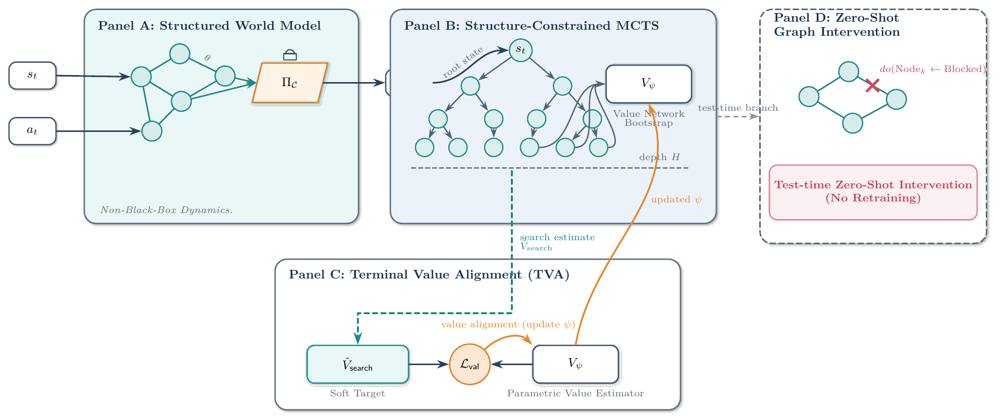
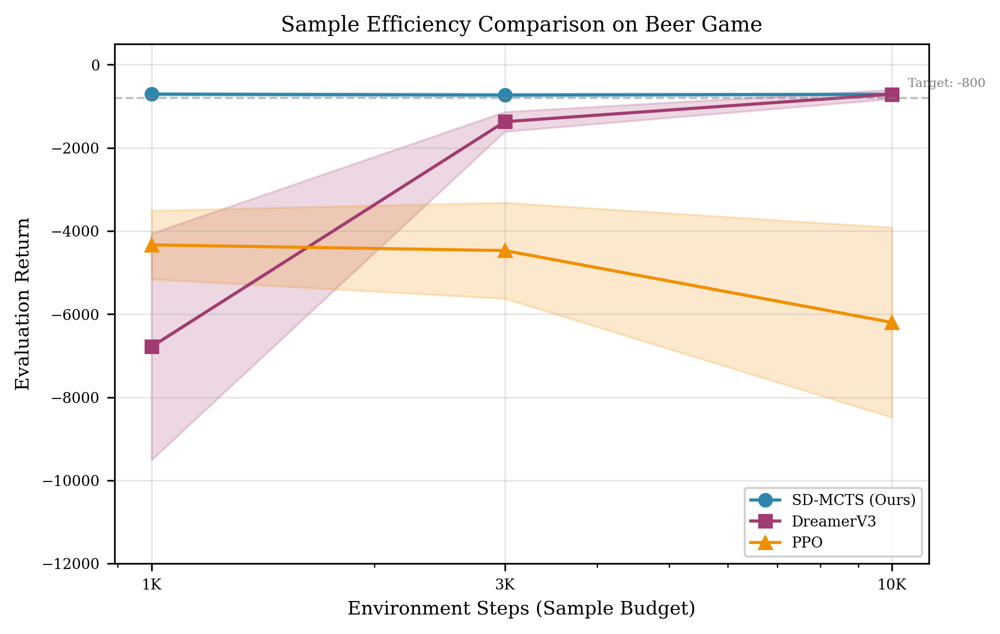
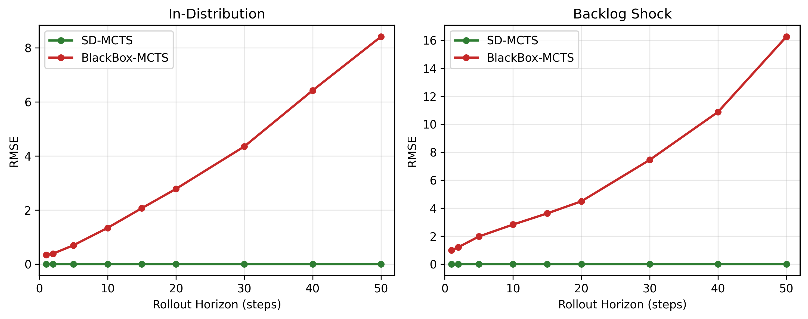
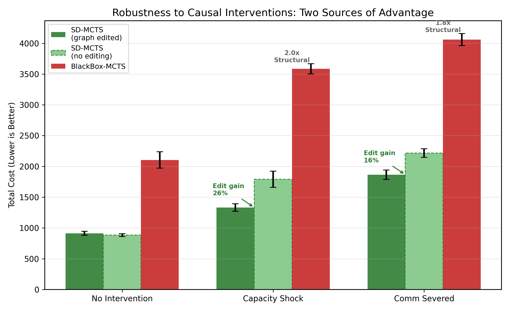

<!-- _class: lead -->

# Structured World Models for Sample-Efficient Planning

## 面向高效采样规划的结构化世界模型 — **SD-MCTS**

System Dynamics × Monte Carlo Tree Search × Terminal Value Alignment

<br>

<small>CEM208 · NUAA</small>

---

## 路线图（Outline）

1. **动机**：黑盒 MBRL 的三个结构性痛点
2. **核心设问**：能否把已知结构注回模型？
3. **方法（Method）**：SD-MCTS 的四个模块
4. **理论（Theory）**：四个命题，结构化在哪里赢
5. **实验（Experiments）**：Beer Game / Cartpole-Swingup / Hopper-Hop
6. **讨论与局限**：action masking 为什么不够；下一步走向
7. **Takeaways** + Q&A

> 论文核心主张：在结构先验明确的任务上，**规划质量的提升主要来自偏差控制（bias reduction），而非更大模型或更多样本（variance reduction）**。

---

## 1. 起点：MBRL 的"白板学习"范式

**主流 MBRL（Dreamer 系列、MuZero、TD-MPC2）的共同选择：**

- 把环境动力学塞进**高维隐空间**（latent space）
- 用 RSSM / Transformer / MLP 自回归地从 0 开始学转移
- 在 Atari、DMControl 等同质化模拟器上经验泛化能力强

**但当我们换到**：

- 物流供应链调度
- 长期设备老化控制
- 流行病学 / 物理过程 …

**这些场景共同特征**：交互昂贵、容错要求高、底层结构已知。

> ❓ 既然多数复杂系统运行在已被科学界长年提炼的物理法则之上，
> 为何要求智能体在缺乏结构先验的条件下，于隐空间重新学这些守恒规律？

---

## 2. 黑盒 MBRL 的三个结构性痛点


| 痛点                 | 表现                                                 | 根因                                               |
| -------------------- | ---------------------------------------------------- | -------------------------------------------------- |
| **样本效率不足**     | $10^3 \sim 10^4$ 步预算下隐空间模型难以稳定收敛      | 缺乏归纳偏置，需从噪声中学守恒                     |
| **外推阶段约束违反** | 多步展开出现**负库存**、**非物理状态**、误差几何放大 | 转移核未嵌入守恒约束；事后裁剪只管动作不管想象轨迹 |
| **因果干预脆弱**     | 容量冲击、链路中断等突变发生时性能塌陷               | 规则与参数耦合在权重里，无法局部编辑               |

**关键观察**：Action masking / state clamping 只处理*执行动作*的合法性，
但**搜索树内部的想象轨迹**已经污染了 Q 估计。

---

## 3. 一个直观引子：啤酒游戏（Beer Game）

经典四级供应链：**工厂 → 分销商 → 批发商 → 零售商**

- 信息延迟 2 步、物流延迟 2 步 ⇒ 系统固有 2~3 步延迟
- 终端需求扰动会被链路逐级放大 → **牛鞭效应（Bullwhip Effect）**

**这是教科书级的 SD（System Dynamics）问题**：

- **Stock**：各级库存 / 积压
- **Flow**：到货、发货、下单、需求满足
- **Feedback**：库存低 → 积压升 → 后续订货调整（带时滞）

> 我们已经知道这个图谱。让 MLP 重学一遍是浪费。

---

## 4. 核心设问与本文回答

**设问**：能否把"结构已知 + 参数未知"显式利用起来？

**SD-MCTS 的回答**：把学习压缩到**少量未知物理参数 + 终端价值估计**，
让"建模"和"求解"都在结构化骨架上发生。

<br>

**三句话总结**：

1. **结构化世界模型** 替代黑盒 latent dynamics — 仅辨识低维 $\theta$
2. **结构约束 MCTS + 终端价值对齐（TVA）** — 浅搜索 + 长视野
3. **因果图可编辑** — 干预可观测时无需重训神经网络

---

## 5. 关键术语：本文的"SD"是 Forrester 式 SD

> ⚠️ 本文 **System Dynamics** 特指 **Forrester (1961) / Sterman (1989)** 的
> **Stock-Flow-Feedback** 建模范式，**不是**任意黑盒动力系统拟合。


| 元素         | 含义                   | Beer Game 实例             | Cartpole 实例          |
| ------------ | ---------------------- | -------------------------- | ---------------------- |
| **Stock**    | 随时间积分演化的状态量 | 库存、积压                 | 位置、角度             |
| **Flow**     | 节点间转移、补给、消耗 | 发货、下单、需求满足       | 重力、惯性耦合项       |
| **Feedback** | 当前状态影响未来流量   | 积压 → 订货调整（带时滞） | 偏离平衡 → 修正难度↑ |

**关键设计**：一步状态更新由"存量变化 = 流入 − 流出 + 局部作用"组合而成，
而非由黑盒函数值直接给出。

---

## 6. 问题形式化：Structured MDP

**设定**：$\mathcal{M} = \langle \mathcal{S}, \mathcal{A}, \mathcal{P}, \mathcal{R}, \gamma \rangle$，
物理可行域 $\mathcal{C} \subseteq \mathcal{S}$，投影算子 $\Pi_{\mathcal{C}}$ 非扩张。

**假设 1（结构-参数分离）**：

$$
s_{t+1} = f(s_t, a_t; \theta^\star) + \xi_t
$$

- $f$ 的解析形式（守恒、非负、拓扑耦合）**已知**
- 未知部分仅为低维参数 $\theta^\star \in \Theta \subset \mathbb{R}^d$
- 噪声 $\xi_t$ 零均值、有界二阶矩；$f$ 对 $\theta$ 可微，对 $(s,a)$ 局部 Lipschitz

**假设 2（低维参数流形 + 确定性均值动力学近似）**：

$$
d = \dim(\theta^\star) \ll \dim(\mathcal{S}) + \dim(\mathcal{A})
$$

> 后续的样本复杂度优势就建立在 **有效自由度只有 $d$** 之上。
> 训练和 rollout 中利用噪声零均值性质，以确定性前向动力学作为条件期望代理，从而降低长时域反向传播的梯度方差。

---

## 7. SD-MCTS 整体架构




---

## 8. 模块 A：可微结构化世界模型

**参数化**：

$$
\hat{s}_{t+1} = \hat{\mathcal{P}}_\theta(s_t, a_t)
              = \Pi_{\mathcal{C}}\bigl(f_{\mathcal{T}}(s_t, a_t; \theta)\bigr)
$$

- $\mathcal{T}$：已知因果拓扑（**不学**）
- $f_{\mathcal{T}}$：在该拓扑上由局部方程拼接的可微算子（**结构固定**）
- $\theta$：少量待估参数（**唯一可学**）
- $\Pi_{\mathcal{C}}$：投影回非负 / 容量 / 守恒可行域

**学习目标**（重构损失）：

$$
\mathcal{L}_{\text{model}}(\theta) =
\mathbb{E}_{(s_t,a_t,s_{t+1}) \sim \mathcal{D}}
\left[\left\|s_{t+1} - \hat{\mathcal{P}}_\theta(s_t, a_t)\right\|_2^2\right]
$$

**收益**：自由度集中在 $\theta$，多步前推时主要结构关系被钉死，误差不易发散。

---

## 9. 模块 B：Structure-Constrained MCTS

**单次迭代三步走**：

**① 选择（UCB）**

$$
a^\star = \arg\max_a \left[Q(s,a) + c_{\text{ucb}} \sqrt{\tfrac{\log(N(s)+1)}{N(s,a)+1}}\right]
$$

**② 扩展与模拟**：在 $\hat{\mathcal{P}}_\theta$ 上前向至深度 $H$；
所有想象状态都被 $\Pi_{\mathcal{C}}$ 保持在可行域内。

**③ 叶节点自举与回传**

$$
\hat{G}_H = \sum_{k=0}^{d-1}\gamma^k \hat{r}_{t+k} + \gamma^d V_\psi(\hat{s}_{t+d})
$$

**关键不同于黑盒 MCTS**：搜索树**内部**的每一个想象状态都是物理可行的——
不是事后裁剪，是**结构层面**的可行性。

---

## 10. 模块 C：终端价值对齐（TVA）

**问题**：树搜索复杂度 $\mathcal{O}(|\mathcal{A}|^H)$ 随深度指数爆炸。
但单步 TD 又只给短视价值估计。

**做法**：用 MCTS 树统计构造软目标，**反过来**提供给价值网络：

$$
\hat{V}_{\text{search}}(s_t) = \sum_a \pi_{\text{mcts}}(a|s_t)\, \hat{Q}_H(s_t,a),
\quad
\pi_{\text{mcts}}(a|s_t) = \frac{N(s_t,a)^\alpha}{\sum_b N(s_t,b)^\alpha}
$$

$$
\mathcal{L}_{\text{val}}(\psi) =
\underbrace{\mathbb{E}\!\left[\bigl(V_\psi(s_t) - \mathrm{sg}(\hat{V}_{\text{search}}(s_t))\bigr)^2\right]}_{\text{TVA Alignment Loss}}
+ \lambda_{\text{td}} \underbrace{\mathbb{E}\!\left[\bigl(V_\psi - (r_t + \gamma \bar{V}_\psi(s_{t+1}))\bigr)^2\right]}_{\text{1-step TD Target}}
$$

**互相强化的闭环**：MCTS 用 $V_\psi$ 补长期视界；$V_\psi$ 又对齐 MCTS 截断回报目标。

---

## 11. 模块 D：共享先验 + 按种子微调

**为什么需要它？** 在 Cartpole 这类**敏感状态**任务上：

- 单种子训 $V_\psi$ → 状态覆盖差异 → 跨种子估值方差大
- 敏感区间（近竖直）方差被进一步放大 → 直接污染叶节点自举

**协议**：

1. **共享价值先验**：在与评测种子分离的开发种子上训 $V_\psi^{\text{prior}}$
2. **按种子微调**：以 $V_\psi^{\text{prior}}$ 为初始化，在每个目标种子上微调

**目标**：在"共享稳定先验"与"保留个体适配"之间取平衡，
不抹平所有差异，但消除系统性的种子塌缩。

---

## 12. 模块 E：因果图上的零样本干预

**场景**：环境发生**已观测**的结构突变（容量受限、链路中断…）

**黑盒模型**：规则与权重耦合 → 灾难性遗忘 → 需重训

**SD-MCTS**：把干预 $\iota_t$ 直接映射为结构方程的局部修改

$$
f \leftarrow g(f, \iota_t), \quad \iota_t \in \mathcal{I}
$$

具体例子：

- **容量冲击**：`production_capacity: 20 → 2` 在 $t \geq 15$ 生效
- **链路中断**：批发商订货流在 $10 \leq t \leq 20$ 被强制置零

**得到的能力**：测试时**重新跑 MCTS 即可**，无需任何神经网络重训。

---

## 13. 理论 1：结构化推断的样本复杂度（命题 1）

**SD-MCTS（结构化）**：在持续激励 $\lambda_{\min}(\Sigma) \geq \mu > 0$ 下，
$\|\hat{\theta} - \theta^\star\|_2 \leq \epsilon$ 以概率 $1-\delta$ 所需样本：

$$
N_{\text{SD}} = \mathcal{O}\!\left(\frac{\sigma^2}{\mu} \cdot \frac{d + \log(1/\delta)}{\epsilon^2}\right)
$$

**对照（无结构表格型 MDP）**：

$$
N_{\text{tab}} = \Omega\!\left(\frac{|\mathcal{S}|^2 |\mathcal{A}| \log(1/\delta)}{\epsilon^2}\right)
$$

**核心化归**：把"估高维转移"问题 → "标定低维物理常数"问题。
这就是 Beer Game 在 1k 步就能用、DreamerV3 要 10k 步追平的根因。

---

## 14. 理论 2：多步误差上界（命题 2）

**黑盒 MLP**（全局 Lipschitz 常数 $L_f > 1$）：

$$
e_H^{\text{MLP}} \leq L_f^H e_0 + \tfrac{L_f^H - 1}{L_f - 1}\epsilon_{\text{model}} = \mathcal{O}(L_f^H)
$$

**SD（守恒 + 非负投影**，闭凸下投影非扩张）：

$$
e_H^{\text{SD}} \leq
\begin{cases}
e_0 + H\,\epsilon_{\text{model}} = \mathcal{O}(H), & L_f = 1 \\
e_0 + \frac{\epsilon_{\text{model}}}{1 - L_f} = \mathcal{O}(1), & 0 \leq L_f < 1
\end{cases}
$$

**经验测算**（Beer Game 主实验工作区间）：$\hat{L}_f \approx 0.96$ ⇒ 落入 $\mathcal{O}(1)$ 区间。

> 一句话：**指数 vs 常量**——结构约束直接改变了误差递推的阶数。

---

## 15. 理论 3：截断视界 vs 终端价值（命题 3）

**Oracle MPC**（拥有真 $\theta^\star$，但 $V_H = 0$）：截断偏差 $\leq \tfrac{\gamma^H R_{\max}}{1-\gamma}$

**SD-MCTS**（带偏 $\hat{\theta}$，但有 $V_\psi$）：在以下条件下严格优于 Oracle MPC：

$$
\underbrace{L_\theta\,\delta_\theta}_{\text{SD 参数误差}} +
\underbrace{\gamma^H \epsilon_V}_{\text{折扣终端误差}} <
\underbrace{\tfrac{\gamma^H R_{\max}}{1-\gamma}}_{\text{Oracle 视距盲区}}
$$

**含义**：当**有效时间跨度 $\tau \gg H$**时，深度扩展是负担、终端价值是收益。
SD-MCTS 的"短深度 + 宽分支 + 终端补偿"正是这一权衡的稳健解。

---

## 16. 理论 4：黑盒 Q 估计的不可约偏差（命题 4）

把 Q 估计误差分解为 **bias + variance**：

$$
\hat{Q}_n(s,a) - Q_H^\pi(s,a) = b_H(s,a) + \varepsilon_n(s,a),\quad
\varepsilon_n = \mathcal{O}_p(n^{-1/2})
$$


| 模型                       | 偏差项$b_H$                                          | 当$n \to \infty$        |
| -------------------------- | ---------------------------------------------------- | ----------------------- |
| 黑盒 MLP（$\gamma L > 1$） | $\|b_H^{\text{BB}}\| \leq C_{\text{BB}}(\gamma L)^H$ | **不消失** ❌           |
| SD（守恒 +$L_f < 1$）      | $\|b_H^{\text{SD}}\| \leq C_{\text{SD}}$（常量）     | 理想匹配下$\equiv 0$ ✅ |

**推论**：黑盒方法不论加多少样本、调多少 rollout，
**不可约偏差仍随规划深度指数放大**。
这才是 SD-MCTS 样本效率优势的根源——**不是方差小，而是偏差被结构化抑制**。

---

## 17. 实验：三个互补的环境


| 环境                 | 特性                       | 检验什么                               |
| -------------------- | -------------------------- | -------------------------------------- |
| **Beer Game**        | 离散、长延迟、可干预       | 样本效率 + 物理一致性 + 零样本干预     |
| **Cartpole-Swingup** | 连续欠驱动、敏感状态       | 公开基准 + 跨种子稳健性                |
| **Hopper-Hop**       | 高难度、稀疏奖励、接触切换 | 结构化方法在复杂运动控制上的低预算极限 |

**基线**：DreamerV3（通用 MBRL）、PPO（Model-free）、BlackBox-MCTS（结构消融）、
1-Step VNet Lookahead（树搜索消融）、Oracle MPC（理论上界参照）。

> 报告口径统一：**跨种子标准差**（across-seed standard deviation），
> 主结果均 3 种子 × N 个评测 episode。

---

## 18. 实验 1A：Beer Game 样本效率（Table 1 / Table 4）


| 样本预算  | **SD-MCTS (Ours)** | DreamerV3      | PPO            |
| --------- | ------------------ | -------------- | -------------- |
| 1,000 步  | **−710 ± 45**    | −6785 ± 3852 | −4335 ± 1166 |
| 3,000 步  | **−731 ± 57**    | −1373 ± 335  | −4472 ± 1632 |
| 10,000 步 | **−713 ± 32**    | −713 ± 157   | −6200 ± 3230 |

**两个核心读法**：

1. **极低样本区间（1k）**：SD-MCTS −710 vs DreamerV3 −6785，**差近 10 倍**
2. **追平区间（10k）**：DreamerV3 才追上 SD-MCTS 已稳定的水平

> 结论：SD-MCTS 的核心价值**不是回报上限更高，而是把进入"可用区间"的数据门槛拉低一个数量级**。



---

## 19. 实验 1B：搜索树内部的物理一致性（Table 2）

**受控对照**：固定 MCTS 框架 + 终端价值 + 训练数据，**只换世界模型**。


| 指标               | **SD-MCTS**        | **BB-MCTS（无结构 MLP）** |
| ------------------ | ------------------ | ------------------------- |
| 想象状态物理违规率 | **0.00% ± 0.00%** | 93.66% ± 1.95%           |

<small>定义：搜索树内每一个想象状态在物理相关 24 维上是否出现负值；
3 种子 × 10 episode × 600 想象状态 = 每种子 18000 个观测点。</small>

**关键论点**：

> action masking 只能规范"输出动作"的合法性，
> **无法避免搜索树内部已经生成、并参与回传的非物理状态**。

证据链：**物理一致性（Table 2）⇒ 多步误差有界（Fig 3）⇒ 规划回报更优（Table 1）**

---

## 20. 实验 1C：多步预测误差链（Fig 3）



- **BlackBox**：误差从 $H=1$ 的 0.345 → $H=10$ 的 1.343 → $H=50$ 的 8.412
  - 平均增长 **6.35% / 步**，约 **11 步翻倍**
- **SD-MCTS**：在确定性 Beer Game 上多步 RMSE 维持 0
- 与命题 2 的"$\mathcal{O}(L_f^H)$ vs $\mathcal{O}(1)$"完全对齐

---

## 21. 实验 2：因果干预下的零样本鲁棒性（Table 3）

**实验设计**：训练时**完全无干预**，测试时注入两类突变。


| 干预类型     | **SD（编辑）**  | **SD_no_update** | **BB**      | 编辑增益   | 结构精度增益 |
| ------------ | --------------- | ---------------- | ----------- | ---------- | ------------ |
| 基准（none） | 913 ± 57       | **884 ± 40**    | 2104 ± 231 | −3.4%     | 2.38×       |
| 容量冲击     | **1331 ± 107** | 1791 ± 230      | 3585 ± 144 | **+25.7%** | 2.00×       |
| 链路中断     | **1865 ± 132** | 2216 ± 122      | 4059 ± 171 | **+15.9%** | 1.83×       |

**两层增益叠加**：

1. **结构先验本身**：BB 4059 → SD_no_update 2216（守恒约束保留⇒规划不偏离物理逻辑）
2. **结构编辑**：再降至 SD 1865（外部信息直接进入内部转移过程）



---

## 22. 实验 3A：Cartpole-Swingup 公开基准（Table 5）

**协议**：35k 共享先验预训练 + 5k 单种子微调；3 个目标种子；离散 11 个动作 bins。


| 方法                           | 环境交互步数 | 均值回报          | 最差种子回报 |
| ------------------------------ | ------------ | ----------------- | ------------ |
| **SD-MCTS（共享先验 + 微调）** | **35k + 5k** | **802.9 ± 21.3** | **772.8**    |
| DreamerV3 (proprio, 官方)      | 500k         | 850.0             | —           |

**对比口径**：

- 真实环境交互 ≈ DreamerV3 的 **1/12**
- 总可训练参数 17,284，其中 SD 本体仅 **3 个物理参数** ≈ DreamerV3 的 **1/460**
- 三种子分别 772.8 / 817.9 / 818.2，**无单种子 < 700**

> ⚠️ 我们**不是**在宣称超越 Cartpole 高预算 SOTA，而是说明：
> **底层动力学已知时，把学习压缩到少量参数 + 价值估计仍能进入较高分数区间**。

---

## 23. 实验 3B：树搜索的补充消融（Table 5）

**目的**：把"结构化世界模型 + 终端价值"和"在线 MCTS"的贡献拆开。
**协议**：完全相同的 checkpoint，仅把决策替换为 1-step VNet Lookahead。


| 方法                    | 均值回报  | Seed 0    | Seed 42   | Seed 84   |
| ----------------------- | --------- | --------- | --------- | --------- |
| **SD-MCTS（完整规划）** | **802.9** | **772.8** | **817.9** | **818.2** |
| 1-Step VNet Lookahead   | 779.9     | 751.0     | 781.9     | 806.7     |

**三点结论**：

1. 即使移除树搜索，**结构化模型 + $V_\psi$** 仍能拿 779.9（说明对照非过弱）
2. 完整 MCTS 稳定带来 +23.0 的均值增益，敏感种子（Seed 42）尤其明显
3. 因此 802.9 不能归功于单一组件——是**结构 + 价值 + 在线规划**三方合力

---

## 24. 实验 4A：Hopper-Hop（Table 6）

**为什么加 Hopper？** 比 Cartpole 更难：接触切换、相位转换、稀疏奖励。
**实现差异**：保留 TD-MPC2 求解闭环，**只把世界模型换成结构化 SD 主干**。


| 方法                                       | 50k                | 100k               | 200k                |
| ------------------------------------------ | ------------------ | ------------------ | ------------------- |
| **Mechanism-oriented SD（Ours, 3 seeds）** | **18.13 ± 12.82** | **61.14 ± 11.67** | **206.90 ± 42.24** |
| TD-MPC2（官方, 3 seeds）                   | —                 | 13.63 ± 10.41     | 166.63 ± 34.89     |
| DreamerV3（官方, 3 seeds）                 | —                 | 9.67 ± 13.60      | 51.17 ± 50.40      |

**关键读法**：

- **50k 三种子均值（18.13）已超越 TD-MPC2 / DreamerV3 在 100k 的官方均值**
- 200k 单种子分别 185.62 / 265.87 / 169.19，全面超过 TD-MPC2 200k（166.63）

---

## 25. 实验 4B：Hopper 的更深启示

**Hopper 与 Cartpole 的本质差别**：

- Cartpole：单一控制目标（保持竖直）
- **Hopper**：成功跳跃 = **机体抬升 → 支撑卸载 → 离地间隙 → 姿态保持 → 竖直速度** 的串联

**这些条件大多先于显式奖励出现** ⇒ 仅靠环境回报很难辨认"正在朝成功演化"

**SD 主干显式表示**：高度、支撑、压缩、摆动、离地间隙、冲击 …
**规划侧**：planning reward + viability gate + 课程式塑形（curriculum shaping） + height_head 辅助监督

> **一句话启示**：
> 结构化收益不止"建模侧结构化"，还需要"求解侧结构化"——
> **结构量必须同时进入动作评估、搜索偏置和训练信号**，才能在低预算阶段稳定收敛。

---

## 26. 一个常见质疑：为什么不用 action masking？

**质疑**：黑盒模型出现非物理预测，加个 action masking / state clamping 不就行了？

**回答**：能管住"输出动作"，但管不住"想象轨迹"。


| 层面         | Action Masking     | 结构约束               |
| ------------ | ------------------ | ---------------------- |
| 关注对象     | 最终执行动作       | 内部一步动力学         |
| 修补时机     | 事后（post-hoc）   | 模型层面（structural） |
| 树内想象状态 | **仍可能违反物理** | **始终可行**           |
| 价值回传     | 从失真轨迹回传     | 从物理一致轨迹回传     |
| 影响         | 系统性 Q 偏差保留  | 偏差被结构化消除       |

> **核心区分**：动作可行性（feasibility）≠ 轨迹动力学保真（fidelity）。
> Table 2 的 0% vs 93.66% 违规率正是这一区分的实证。

---

## 27. 局限性（Limitations）

<style scoped>
section { font-size: 20px; padding: 30px 50px; }
section h2 { font-size: 26px; }
</style>

诚实地说，这套框架仍有边界：

1. **结构已知假设**

   - 适用于具明确机理约束的工程系统
   - 若先验结构本身有偏，预测与规划质量受限
   - 未来：结合**因果结构修正**而非只学参数
2. **理想动力学假设**

   - 当前实验数据来自仿真器（无显著观测噪声 + 无未建模残差）
   - 现实问题更常见"主体机制 + 随机扰动 + 未建模残差"并存
   - 未来：保留 SD 主体 + 引入**残差网络**吸收未覆盖成分
3. **大规模动作空间扩展性**

   - 当前 MCTS 在 Cartpole 已需离散化为 11 bins
   - 高维连续控制下分支爆炸
   - 未来：与**策略引导搜索 / 分层规划 / 候选动作生成**结合

---

## 28. 更广泛的启示

**当结构先验明确、真实交互昂贵、模型失真代价高时**：

直接利用领域机理构造世界模型，比完全依赖黑盒函数逼近**更容易获得稳定的早期规划性能**。

**学习与规划不一定要遵循**：
"先学一个通用隐空间模型 → 再让搜索/策略去利用"

**也可以是**：
"先固定主要结构 → 再学习少量未知参数 + 终端价值补偿"

> 这是一个介于"黑盒 MBRL"与"传统 MPC"之间的**中间方案**——
> 既不放弃可学习性，也不放弃可解释性与可编辑性。

未来值得推进的方向：更一般的结构化表示、更灵活的结构修正、与连续控制的更紧密结合。

---

## 29. Takeaways

<br>

✅ **核心主张**：在结构先验明确的任务上，规划质量提升主要来自**偏差控制**，
而非更大模型或更多样本。

✅ **方法骨架**：结构化世界模型 + Structure-Constrained MCTS + TVA + 共享先验微调 + 因果图编辑

✅ **理论保证**：样本复杂度 $\mathcal{O}(d/\epsilon^2)$、多步误差 $\mathcal{O}(1)$、不可约偏差被消除

✅ **实证证据**：

- Beer Game 1k 步即接近 10k 步水平（vs DreamerV3 慢 10×）
- Cartpole 用 1/12 数据 + 1/460 参数达到接近 SOTA 的分数区间
- **Hopper 50k 三种子均值（18.13）已超越 TD-MPC2 / DreamerV3 100k 官方均值**

✅ **关键区分**：动作可行性 ≠ 轨迹动力学保真；事后裁剪不能替代结构约束。

<br>

---

## 30. 延伸案例：航空发动机 RUL 预测（Phase-2 扩展）

**为什么再讲一个非控制案例？** 把同一结构化骨架从"在线控制"升级到
"长时域预测 + 健康管理"，检验 SD-MCTS 范式能否跨物理域复用。

**三处语义重构（control → prognosis）**：

| 维度 | 原始控制语义 | Phase-2 健康管理语义 |
|---|---|---|
| **问题** | 选动作最大化回报 | 退化状态长时域 rollout + RUL 估计 |
| **训练** | model + 终端 $V_\psi$ | SD 主干 + 受限 residual + 协议读出 |
| **规划** | MCTS 树搜索 | 结构化 rollout + stress / route 反事实 |

> 方法边界（关键设计契约）：
> **SD 主导 latent evolution；residual 只补结构外余量（[受限不可逆残差]）；readout 只做 benchmark 对齐**。
> 三者层级分明，黑盒分支不替代结构化推演。

---

## 31. C-MAPSS FD001 上的局部 SD-TVA 模型

<style scoped>
section { font-size: 20px; padding: 30px 50px; }
section h2 { font-size: 26px; }
table { font-size: 17px; }
</style>

> **为什么叫 "local"？** FD001 只给传感器观测、没有内部结构图，无法做全局开环 SD 推演；
> 因此把 SD 语义降级到 **rolling window 尺度**——只估计当前局部状态与到边界距离。

**输入**：30-cycle rolling window 的 14 路传感器 → 压缩为**具有物理语义**的局部 SD 状态：

```
damage_stock | damage_flow | stress_memory | buffer_stock |
efficiency_loss | flow_loss | thermal_warning |
3× route margins | global_margin | local_time_to_boundary
```

**双 residual（route-exclusive，机制层级互不重叠）**：

- `dynamics residual` 只补 flow / stress memory / buffer / thermal 增量
- `component residual` 只校 efficiency / margin / time-to-boundary 读出

**RUL 读出空间 trust-region**（核心约束）：

$$
\mathcal{L}_{\Delta} = \mathbb{E}\!\left[\left(\frac{f(s + \delta s) - f(s)}{C}\right)^2\right]
$$

> 限制 residual 在**任务度量空间**的有效跳跃，而非状态坐标空间。
> 这把 residual 紧紧钉在 SD 主干附近，杜绝它退化为黑盒 RUL 旁路。

---

## 32. 结果：竞争性精度 + 显著轻量化（4 seeds: 3/5/7/11）

<style scoped>
section { font-size: 20px; padding: 30px 50px; }
section h2 { font-size: 26px; }
table { font-size: 17px; }
</style>

**Trust-region 权重扫描**（同一 SD-TVA backbone）：

| 协议 | Final RMSE | PHM08 | MAE | 角色 |
|---|---:|---:|---:|---|
| 无约束 dual residual | 14.82 ± 1.13 | 444.7 ± 162.6 | 11.35 | 基线 |
| trust-region $w=0.10$ | 14.32 ± 0.86 | 388.6 ± 115.7 | 10.92 | 中等约束 |
| **trust-region $w=0.20$** | **13.94 ± 0.67** | **335.9 ± 86.6** | **10.58** | **当前主线** |

**关键反向证据**：约束**越强**、精度和 seed 稳定性**越好** — 直接验证"residual 应作为 SD 主干周边的局部校正"这一设计判断。

**Pareto 对照（标准 FD001 协议）**：

| 方法 | RMSE | PHM08 | 参数量 | 训练 | 反事实接口 |
|---|---:|---:|---:|---|---|
| MambaAtt (RESS '26) | 11.46 | 201 | ~10⁵–10⁶ | GPU | ✗ |
| PSTFormer (ESWA '25) | 12.08 | 224.6 | ~10⁵–10⁶ | GPU | ✗ |
| **本文 local SD-TVA** | **13.94** | **335.9** | **32,786** | **CPU 分钟级** | **✓ 显式** |
| Zheng et al. vanilla LSTM (ICPHM '17) | 16.14 | 338 | ~10⁴–10⁵ | GPU | ✗ |

> 经典 LSTM (16.14) → 现代黑盒 SOTA (11–12) → 本文 (13.94)；
> RMSE 处于中间区间，但**参数量比 SOTA 少 1 个数量级**、CPU 分钟级训练、原生反事实接口。
> **不追逐黑盒 SOTA，追求可解释 + 轻量 + 可推演的 Pareto 位置**。

---

## 33. 解释性 + 反事实 + 传感器异常归因

<style scoped>
section { font-size: 20px; padding: 30px 50px; }
section h2 { font-size: 26px; }
table { font-size: 17px; }
</style>

**① 状态链可审计**：误差不再是黑盒数字，可定位到 SD 状态/route margin/TVA 读出层级
（典型 hard 样本 unit 45：target 114 → SD base 50 → final 66，定位为 `damage_stock` 暴露不足）。

**② 结构化反事实**（同一 final state，仅扰 SD 驱动坐标）：

| 扰动 | unit 51 RUL | global_margin | unit 45 RUL |
|---|---:|---:|---:|
| 基线 | 102.4 | 0.280 | 58.7 |
| `stress_relief` | **108.1** ↑ | 0.296 ↑ | **66.6** ↑ |
| `stress_high` | 94.8 ↓ | 0.263 ↓ | 51.8 ↓ |

> 结论由 `damage_flow → margin → TTB → TVA` **结构链条**给出，不是直接改标签。

**③ 传感器异常诊断**（T50_s4 +1.0 模拟温度漂移）：

```
T50_s4 ↑  →  thermal_warning ↑  →  global_margin ↓  →  local TTB ↓  →  RUL 系统性低估
```

> 逆向定位：从"RUL 低估"反推到"温度通道异常 + 热风险机制"——
> **模型不只给数字，还给故障归因路径**。

---

<!-- _class: lead -->

# 附录


---

## A1. Beer Game 的 SD 实例化细节

**状态（26 维）**：四级节点 × {库存 $I$, 积压 $B$, 在途发货 ship[0:1], 在途订单 order[0:1]} + 时间 + 当期需求

**一步转移（固定顺序）**：

1. 接收 ship[0] 到货
2. 发货与订单管道整体移位
3. 零售端注入需求；其余各级接收上游延迟订单
4. 按 $\min(\text{inventory}, \text{backlog})$ 完成发货
5. 工厂按产能上限生成新补产流

**可学习参数（仅 3 个）**：`demand_low`, `demand_high`, `demand_step_time`

**硬约束**：所有库存/管道每步后截断到非负；工厂补产受 `production_capacity` 约束。

**干预接口**：容量改 `20→2` / 批发商订货流置零——都是**对结构方程局部项的直接编辑**。

---

## A2. Cartpole 与 Hopper 的 SD 实例化

**Cartpole-Swingup（连续解析动力学）**：

- 内部状态 $[x, \theta, \dot{x}, \dot{\theta}]$（先用 atan2 还原）
- RK4 积分器 + dt=0.01
- **可学习仅 3 个**：masscart, masspole, length（重力固定 9.81）
- 滑轨/转轴阻尼按 MuJoCo 配置固定，不学习

**Hopper-Hop（机制态 + 结构求解）**：

- 内部 15 维机制状态：height, vx, vz, pitch, compression, swing, foot_angle, support, clearance, impact …
- 动作分解为 drive / posture / foot 三类控制分量
- **可学习仅 11 个**：control_scale (4) + rate_damping (7)
- 替换的 TD-MPC2 黑盒 latent dynamics 原参数量：300,128
- 训练侧：planning reward + viability gate + curriculum shaping (0.5 → 0.25 在 10k–30k) + height_head 辅助监督

---

## A3. 计算资源开销（Compute Resources）

**硬件**：4× NVIDIA Tesla P100-PCIE-16GB（本地内部服务器，无云 API）


| 实验                          | 单次开销            |
| ----------------------------- | ------------------- |
| Beer Game（1k–10k 区间）     | 0.04 – 0.31 GPU·h |
| Cartpole 共享先验目标种子评估 | 0.61 GPU·h / seed  |
| Hopper 50k 检查点单种子       | 3.9 GPU·h          |

**主结果总预算**：14.8 GPU·h

- Beer Game 三种子 budget sweep: 1.3 GPU·h
- Cartpole 三种子共享先验评估: 1.8 GPU·h
- Hopper 三种子 50k: 11.7 GPU·h

> Cartpole 串行执行；3 GPU 并行可缩 1/3 墙钟。
> Hopper 因 SD overlay 接口、结构态转换、辅助监督未充分优化，相对 plain TD-MPC2 有额外开销。

---

## A4. 数学符号速查表


| 符号                                          | 含义                                               |
| --------------------------------------------- | -------------------------------------------------- |
| $\mathcal{T}, \mathcal{C}, \Pi_{\mathcal{C}}$ | 已知拓扑 / 物理可行域 / 投影算子                   |
| $f_{\mathcal{T}}, \hat{\mathcal{P}}_\theta$   | 结构化更新算子 / 含投影的转移映射                  |
| $\theta, \theta^\star$                        | 待辨识低维参数 / 真值                              |
| $V_\psi, V^\pi$                               | 学习的终端价值网络 / 真实终端价值                  |
| $H, c_{\text{ucb}}, n$                        | 搜索深度 / UCB 系数 / 模拟次数                     |
| $e_t, \epsilon_{\text{model}}, \epsilon_V$    | 第$t$ 步状态误差 / 单步模型误差 / 终端价值逼近误差 |
| $L_f, L_r, L_V$                               | 闭环映射 / 单步奖励 / 终端值的 Lipschitz 常数      |
| $b_H(s,a), \varepsilon_n(s,a)$                | 模型失配的系统性偏差 / 随样本数衰减的随机项        |
| $f \leftarrow g(f, \iota_t)$                  | 结构编辑（零样本干预）                             |

<br>

> 完整数学推导见论文附录 A.7。
