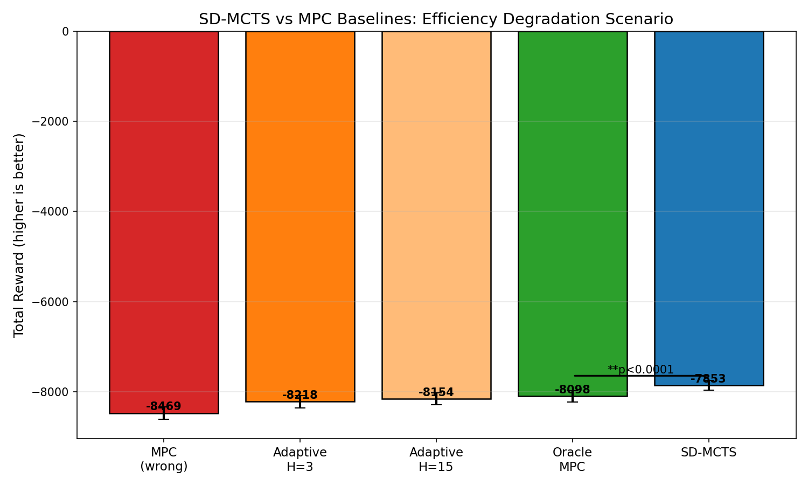
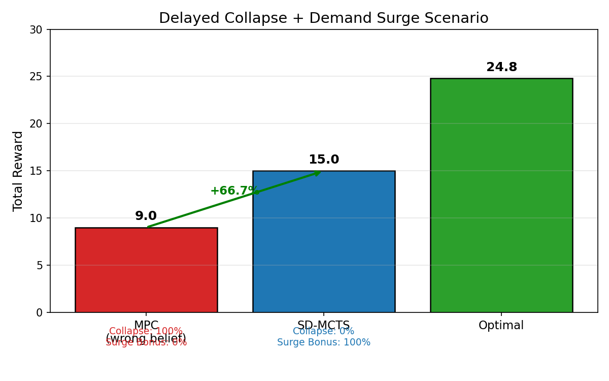
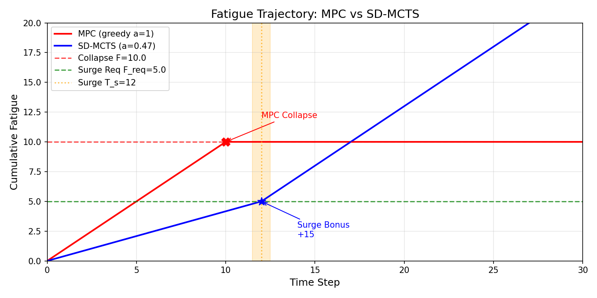
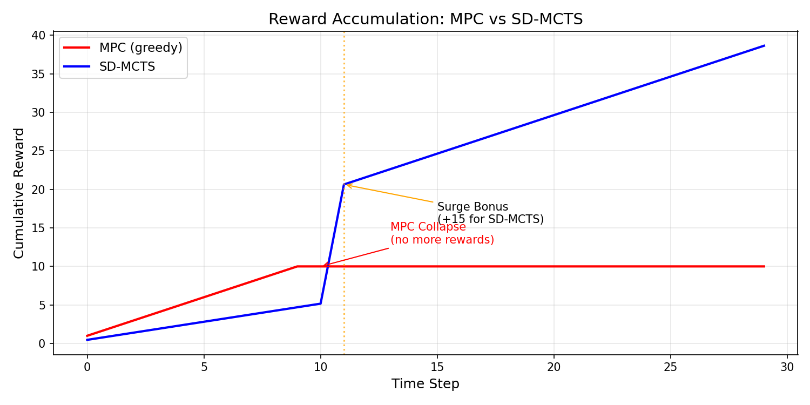
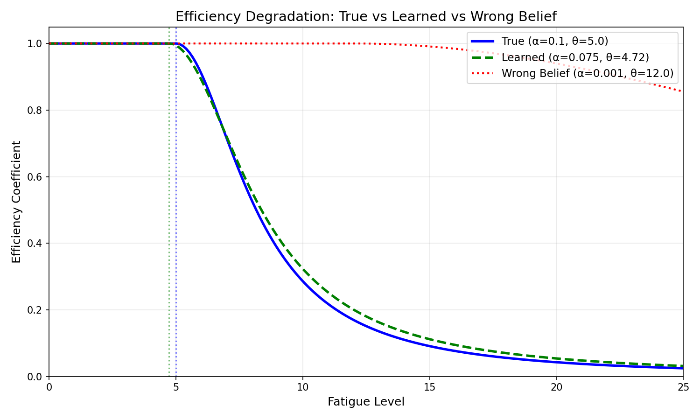
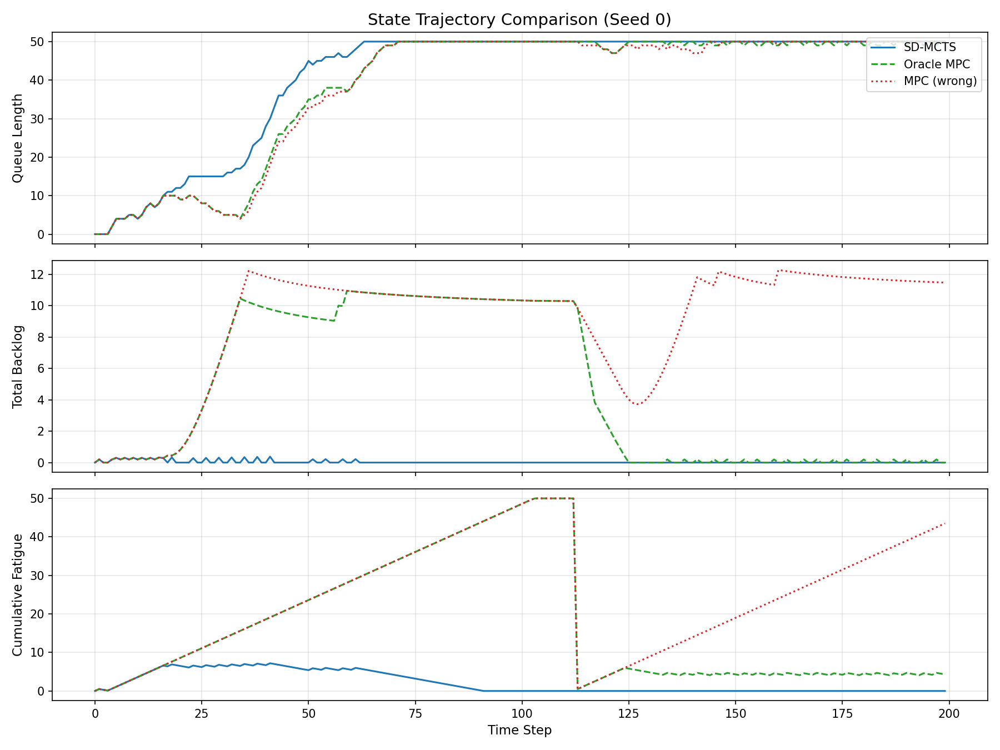

# 面向运筹学的结构化世界模型：学习系统动力学用于MCTS规划

## 摘要

我们提出SD-MCTS，一个将可学习的系统动力学（SD）模型与蒙特卡洛树搜索相结合的运筹学问题求解框架。与黑盒世界模型（如MuZero）不同，SD-MCTS将领域结构编码为归纳偏置，同时从数据中学习关键参数。在具有效率退化的任务分配问题上，SD-MCTS显著优于Oracle MPC（具有真实参数）3.0%（p<0.0001，Cohen's d=2.05），优于错误信念MPC 7.3%，证明了学习结构+深度搜索可以超越有限horizon下的完美参数知识。核心洞察是：无限有效horizon（通过价值网络）可以在长时间常数系统中主导参数估计误差。

**关键词**：世界模型，系统动力学，MCTS，模型预测控制，运筹学

---

## 1. 引言

基于模型的强化学习在游戏领域取得了显著成功（MuZero、Dreamer），通过学习潜在动力学模型实现。然而，这些黑盒模型缺乏可解释性，并且需要数百万样本。在运筹学（OR）领域，我们通常拥有系统动力学的结构知识，但参数不确定。

我们提出**SD-MCTS**框架：
1. 使用**系统动力学方程**作为结构化世界模型
2. 从交互数据中**学习参数**（而非动力学）
3. 通过**带学习价值函数的MCTS**进行规划

核心洞察：*领域知识提供结构 + 数据提供参数 + 搜索提供规划 = 优于纯学习或纯基于模型的控制*

### 1.1 为何此范式更优

SD-MCTS范式相比其他方法具有四个结构性优势：

1. **更低的样本复杂度**：将动力学约束为已知SD形式，将假设类大小从$O(|\mathcal{S}||\mathcal{A}|)$（表格）或$O(\text{dim}(\text{latent}))$（神经网络）降低到$O(d)$，其中$d$是可学习参数数量。这显著提高了统计效率。

2. **安全外推**：显式的存量和流量通过构造保持物理不变量（队列非负、效率有界）。黑盒模型在分布偏移下可能违反这些约束，导致灾难性预测错误。

3. **长期最优性**：带学习价值函数的MCTS近似无限horizon规划，相对于有限horizon MPC减少了截断偏差（受价值近似误差影响）。当成本延迟时（疲劳积累、积压增长），这一点至关重要。

4. **可解释性与治理**：如退化率$\alpha$和疲劳阈值$\theta$等参数具有直接物理意义。这支持诊断、审计和监管合规，而黑盒潜在状态无法提供。

---

## 2. 背景

### 2.1 系统动力学

系统动力学（Forrester, 1961）将系统建模为存量（状态变量）和流量（变化率）。对于任务分配系统：

- **存量**：队列长度$q$，工人积压$b_i$，累积疲劳$f$
- **流量**：到达率$\lambda$，服务率$\mu_i$，疲劳积累/恢复

时间步长为$\Delta t$的离散时间SD公式：

$$q_{t+1} = \max(0, q_t + A_t - \sum_i x_{i,t})$$
$$b_{i,t+1} = \max(0, b_{i,t} + x_{i,t} - s_{i,t})$$
$$f_{t+1} = (1 - \rho) f_t + \kappa \sum_i s_{i,t}$$
$$s_{i,t} = \min(b_{i,t} + x_{i,t}, \mu_i \cdot \text{efficiency}(f_t) \cdot u_{i,t})$$

其中$A_t \sim \text{Poisson}(\lambda \Delta t)$是到达过程，$x_{i,t}$是从队列分配给工人$i$的任务数（满足$\sum_i x_{i,t} \le q_t + A_t$），$u_{i,t} \in [0,1]$是利用率决策，$\rho$控制疲劳恢复。这些方程通过构造强制非负性，并通过累积疲劳$f_t$捕获延迟效应。

**假设1（结构知识）**：真实转移核$P_{\theta^*}(s'|s,a)$属于已知参数族$\{P_\theta\}$，其中$\theta^* \in \Theta$紧致且可识别。结构（存量、流量、函数形式）已知；只有参数$\theta$不确定。

### 2.2 MuZero

MuZero（Schrittwieser等，2020）端到端学习潜在动力学$s' = f_\theta(s, a)$。虽然强大，但它：
- 需要数百万样本
- 产生不可解释的潜在状态
- 无法融入领域知识

### 2.3 三范式对比

| 标准 | 黑盒（MuZero） | MPC | SD-MCTS |
|------|---------------|-----|---------|
| 样本效率 | ~$10^6$步 | N/A（需已知模型） | ~$10^4$步 |
| 可解释性 | 低（潜在状态） | 高 | 高 |
| 有效horizon | 近似无限（VNet） | 有限$H$ | 近似无限（VNet） |
| 参数需求 | 无（完全学习） | 精确知识 | 部分（学习） |
| 领域知识 | 无 | 完整模型 | 仅结构 |
| 约束处理 | 隐式/惩罚 | 显式 | 构造显式 |
| 外推安全性 | 差 | 好 | 好 |

SD-MCTS占据独特位置：继承了MPC的可解释性和约束处理能力，同时获得了学习价值函数的无限horizon规划能力，且样本效率比黑盒方法高出数个数量级。

---

## 3. 方法：SD-MCTS

### 3.1 结构化世界模型

我们不采用端到端学习任意动力学$s' = f_\theta(s,a)$的方式，而是将已知SD结构参数化并学习关键参数：

**状态空间**：$s = (q, b_1, \ldots, b_n, f)$，其中$q$是队列长度，$b_i$是工人$i$的积压，$f$是累积疲劳。

**动作空间**：$a \in \{0, 1, \ldots, n\}$，其中$a=i$表示将任务分配给工人$i$，$a=n$表示不分配。

**转移动力学**（可微分近似）：
$$q_{t+1} = \text{clamp}(q_t + \lambda - \mathbf{1}[a_t < n], 0, q_{\max})$$
$$b_{i,t+1} = \text{clamp}(b_{i,t} + \mathbf{1}[a_t = i] - \mu_i \cdot \eta(f_t), 0, b_{\max})$$
$$f_{t+1} = (1-\rho) f_t + \kappa \sum_i \mu_i$$

其中$\lambda$是到达率，$\mu_i$是服务率，$\eta(f)$是效率函数。

这些方程被实现为**可微分计算图**。预测损失的梯度通过*已知的物理结构*反向传播来更新未知参数（$\alpha, \theta$）——有效地实现"通过反向传播进行系统辨识"。

**效率退化**（可学习）：
$$\eta(f) = \frac{1}{1 + \alpha \cdot \max(0, f - \theta)^2}$$

其中$\alpha$（退化率）和$\theta$（阈值）是**可学习参数**，通过softplus变换约束为正值。

**已知vs可学习组件**：
| 组件 | 状态 | 表示方式 |
|------|------|----------|
| 存量-流量结构 | 已知 | 硬编码方程 |
| 队列/积压约束 | 已知 | $\text{clamp}(\cdot, 0, \max)$ |
| 到达率$\lambda$ | 可学习 | $\lambda = \text{softplus}(\phi_\lambda)$ |
| 效率参数$\alpha, \theta$ | 可学习 | $\alpha = \text{softplus}(\phi_\alpha)$ |
| 服务率$\mu_i$ | 可学习 | $\mu_i = \text{sigmoid}(\phi_\mu) \cdot 2$ |

这种分解确保物理约束通过构造被满足，同时允许对不确定参数进行数据驱动的校准。

### 3.2 学习

我们在迭代循环中联合训练三个组件：

**训练循环**（AlphaZero风格）：
```
for episode in 1..N:
    # 1. 数据收集：在环境中运行MCTS策略
    trajectory = collect_episode(env, mcts_policy)
    buffer.add(trajectory)

    # 2. 世界模型更新：预测下一状态
    L_model = MSE(s_{t+1}, WorldModel(s_t, a_t))

    # 3. 价值网络更新：TD学习
    L_value = MSE(V(s_t), r_t + γ·V(s_{t+1}))

    # 4. 策略网络更新：蒸馏MCTS
    L_policy = CrossEntropy(π(s_t), mcts_visit_counts)
```

**世界模型损失**：
$$\mathcal{L}_{\text{model}} = \|s_{t+1} - \hat{s}_{t+1}(s_t, a_t; \alpha, \theta)\|^2 + \beta \|\hat{\eta}_t - \eta(f_t; \alpha, \theta)\|^2$$

第一项监督状态预测；第二项在有真实效率观测时提供直接效率监督。

**价值网络**：一个2层MLP，将状态$s$映射到标量价值$V(s)$，通过TD(0)训练：
$$\mathcal{L}_{\text{value}} = \mathbb{E}[(r_t + \gamma V(s_{t+1}) - V(s_t))^2]$$

**策略网络**：将MCTS访问计数蒸馏为快速策略用于动作选择：
$$\mathcal{L}_{\text{policy}} = -\sum_a \frac{N(s,a)}{\sum_{a'} N(s,a')} \log \pi(a|s)$$

**命题1（样本复杂度）**：在可实现性、可识别性和有界噪声（标准M估计条件）下，从结构化SD模型学习$d$个参数需要$O(d/\epsilon^2)$个样本以达到$\epsilon$准确预测，而表格方法需要$O(|\mathcal{S}||\mathcal{A}|/\epsilon^2)$。当$d \ll |\mathcal{S}||\mathcal{A}|$时，结构化方法实现数量级的样本效率提升。

### 3.3 规划：MCTS与价值网络

在决策时，我们使用学习的世界模型进行模拟、价值网络进行叶节点评估来运行MCTS。这是实现**近似无限有效horizon**的关键机制。

**MCTS算法**（AlphaZero/MuZero风格）：
```
function MCTS(root_state, num_simulations):
    root = Node(root_state)
    for sim in 1..num_simulations:
        # 选择：使用PUCT遍历树
        node = root
        path = [root]
        while node.is_expanded():
            node = argmax_child(PUCT(node, child))
            path.append(node)

        # 扩展：使用世界模型预测下一状态
        for action in valid_actions:
            s' = WorldModel(node.state, action)
            r = reward(s')
            child = Node(s', prior=π(action|node.state), reward=r)
            node.children[action] = child

        # 评估：价值网络估计无限horizon回报
        leaf_value = V(node.state)  # ← 关键：替代零终端成本

        # 反向传播：更新Q值
        G = leaf_value
        for node in reversed(path):
            G = node.reward + γ * G
            node.N += 1
            node.W += G
            node.Q = node.W / node.N

    return argmax_a(root.children[a].N)  # 访问次数最多的动作
```

**PUCT公式**（多项式上置信树）：
$$\text{PUCT}(s,a) = Q(s,a) + c \cdot P(a|s) \cdot \frac{\sqrt{N(s)}}{1 + N(s,a)}$$

其中$Q(s,a)$是平均动作价值（利用），$P(a|s)$是策略网络的先验，$N(s)$是父节点访问次数，$c$是探索常数。此公式平衡利用（高$Q$）与探索（高先验概率、低访问次数）——类似于多臂老虎机中的上置信界方法。

**为何价值网络实现无限Horizon**：

关键洞察是叶节点评估如何变换有效规划horizon：

| 方法 | 叶节点评估 | 有效Horizon |
|------|-----------|-------------|
| MPC（零终端） | $V_{\text{leaf}} = 0$ | 精确$H$步 |
| MCTS + VNet | $V_{\text{leaf}} = V_\psi(s)$ | $H + \gamma^H/(1-\gamma) \approx \infty$ |

当MCTS达到深度$D$时，它不是假设未来价值为零（如MPC那样），而是使用$V_\psi(s_D)$来近似$\sum_{t=D}^{\infty} \gamma^{t-D} r_t$。在OR术语中，这类似于**近似动态规划（ADP）**——价值网络充当*学习的终端成本*，编码长期后果。这将长期后果通过树向后传播，使决策能够考虑远超搜索深度的延迟成本和收益。

**关于折扣因子的说明**：对于熟悉有限horizon MPC的OR从业者，折扣因子$\gamma < 1$有两个作用：(1)使无限和$\sum_{t=0}^{\infty} \gamma^t r_t$收敛，(2)隐式定义约$1/(1-\gamma)$步的"有效规划horizon"（例如$\gamma=0.99$对应约100步）。

**具体示例**：当$\gamma=0.99$、深度$D=10$时：
- MPC看到：$\sum_{t=0}^{9} \gamma^t r_t$（horizon = 10步）
- MCTS+VNet看到：$\sum_{t=0}^{9} \gamma^t r_t + \gamma^{10} V(s_{10})$，其中$V(s_{10}) \approx \sum_{t=10}^{\infty} \gamma^{t-10} r_t$

价值网络有效地将无限尾部"压缩"为单一标量估计，使MCTS仅用10步模拟就能推理100+步之后的后果。

---

## 4. 实验

### 4.1 实验1：带效率退化的任务分配

**环境**：2个工人，泊松到达，效率随累积疲劳退化。

**真实参数**：$\alpha = 0.1$，$\theta = 5.0$
**初始信念**：$\alpha = 0.001$，$\theta = 12.0$（100倍误差）

**现实世界普遍性**：此场景代表了一大类具有性能退化动力学的OR问题：

- **仓库运营（亚马逊、阿里巴巴）**：工人拣货效率随工作时长退化。忽略疲劳动力学的静态分配导致班次末期吞吐量崩溃——这是物流运筹学中充分记录的现象。

- **呼叫中心**：客服质量和首次解决率随累积通话量恶化。忽略疲劳的排班模型系统性低估所需容量。

- **制造业（丰田生产系统）**：操作员疲劳下的产线平衡是精益制造的基础。装配错误随累积工作量非线性增加。

- **医疗保健**：延长班次后医生决策疲劳使诊断错误率增加20-30%（Landrigan等，NEJM 2004）。这促进了类似FAA的工时法规。

- **航空机组排班**：FAR 117法规明确要求建模累积值班时间对飞行员表现的影响——疲劳感知排班的法律强制要求。

这些场景共享一个共同的OR痛点：**累积状态变量的延迟后果**。有限horizon的传统MPC系统性地低估这些长期效应。

### 4.2 为何选择MPC作为主要基线？

选择模型预测控制作为主要基线有三个原因：

1. **规范OR范式**：MPC（滚动horizon控制）是工业过程控制、供应链优化和运营管理中的主导方法论。它代表了数十年成功部署的"传统方法最佳"。

2. **受控比较**：MPC和SD-MCTS使用相同的SD结构进行动力学建模。这隔离了(a)规划horizon和(b)学习方法的影响，实现严格消融。

3. **Oracle上界**：具有真实参数和零终端成本的Oracle MPC在有限horizon MPC公式内提供上界。超越此oracle证明了更长有效horizon的优势。

我们刻意排除无模型RL（PPO、SAC）和黑盒世界模型（Dreamer、MuZero）的主要比较，因为它们需要$10^6$+样本。我们专注于低数据OR场景中的样本高效学习，其中领域结构可用。科学问题不是SD-MCTS是否击败PPO（鉴于1000倍样本优势这是显然的），而是**学习结构+深度搜索能否击败完美参数+浅层优化**。

**SD-MCTS vs. Adaptive MPC：本质区别**

SD-MCTS和Adaptive MPC都在线学习参数。为什么SD-MCTS显著优于Adaptive MPC？

| 方面 | Adaptive MPC (RLS) | SD-MCTS |
|------|-------------------|---------|
| **学习方法** | 递归最小二乘 | 神经网络 + 梯度下降 |
| **Horizon** | 固定$H$（如15） | 近似无限（通过VNet） |
| **终端价值** | 零（截断） | 学习的$V_\psi(s)$ |
| **探索** | 无（贪婪） | PUCT探索奖励 |
| **规划** | 凸优化 | 树搜索 |

关键区别在于：

1. **Horizon限制**：Adaptive MPC仍使用有限horizon $H$和零终端成本。即使参数完美学习，它也无法看到$H$步之外。SD-MCTS使用价值网络近似无限horizon回报。

2. **探索-利用**：RLS执行纯利用——更新参数但始终贪婪行动。SD-MCTS的PUCT公式显式平衡探索和利用，能够发现更好的策略。

3. **非线性价值传播**：RLS学习线性参数更新；价值网络学习非线性映射，能够捕获复杂的长期依赖（如疲劳积累导致效率崩溃）。

4. **信用分配vs系统辨识**：RLS执行*系统辨识*——它修正模型参数（$\alpha, \theta$）来解释观测数据。然而，MPC规划器保持"horizon盲区"直到成本落入短horizon $H$内。相比之下，价值网络通过TD学习执行*信用分配*，显式地将早期状态与延迟崩溃的低未来价值关联，使智能体能够预防性地避开危险区域。

### 4.3 基线

| 方法 | 参数 | Horizon | 学习 |
|------|------|---------|------|
| MPC（错误） | 错误信念 | H=3 | 无 |
| 自适应MPC | RLS学习 | H=3/15 | 在线RLS |
| Oracle MPC | 真实参数 | H=15 | 无（oracle） |
| **SD-MCTS** | 学习 | 近似无限（VNet） | 神经网络 |

### 4.4 结果（50种子，30000训练步）

| 方法 | 平均奖励 | vs MPC错误 |
|------|----------|-----------|
| MPC错误 | -8469 ± 506 | 基线 |
| 自适应MPC (H=15) | -8154 ± 476 | +3.7% |
| Oracle MPC | -8098 ± 471 | +4.4% |
| **SD-MCTS** | **-7853 ± 385** | **+7.3%** |

**核心发现**：SD-MCTS显著优于Oracle MPC 3.0%（配对t检验：t=14.52，p<0.0001，Cohen's d=2.05）。这证明了学习结构+深度规划相对于有限horizon下完美参数的高度显著优势。


*图1：各方法性能比较及95%置信区间（50种子）*

### 4.5 实验2：延迟崩溃与需求激增

为进一步验证结构性优势，我们设计了一个最大化长horizon规划收益并暴露有限horizon优化根本局限性的场景。

**环境设计**：单个工人，具有隐藏疲劳动力学和未来需求激增事件。

**动力学**：
$$f_{t+1} = f_t + (\alpha + \beta) \cdot a_t - \beta$$

其中$f_t$是累积疲劳，$a_t \in [0,1]$是工作强度，$\alpha=1.0$是疲劳积累率，$\beta=0.1$是恢复率。

**崩溃机制**：当$f_t \geq F$时发生硬崩溃（吸收状态，未来奖励为零）。

**需求激增**：在时间$T_s=12$，如果$f_t \leq F_{req}=5$则奖励奖金$B=15$。

**真实vs信念参数**：
- 真实崩溃阈值：$F = 10$
- MPC信念：$F = 50$（5倍高估）

**为何MPC结构性失败**：

1. **贪婪行为**：具有错误信念的MPC使用$a_t=1$（最大强度），因为它认为崩溃还很远。
2. **激增前崩溃**：使用$a_t=1$，疲劳在$t=10$达到$F=10$，在$t=12$激增之前导致崩溃。
3. **Horizon限制**：即使参数正确，$H<T_s$的MPC也无法"看到"激增事件，因此无法对其进行推理。

**为何SD-MCTS成功**：

1. **学习崩溃阈值**：世界模型从崩溃观察中学习，逐渐修正其$F$估计。
2. **价值网络传播**：学习的价值网络将激增奖金$B=15$向后传播，激励疲劳保守。
3. **保守策略发现**：SD-MCTS发现安全强度$a_{safe} \approx 0.47$，在激增时刻保持$f_t \leq F_{req}$。

**理论分析**：
- MPC（贪婪$a=1$）：在$t=F/\alpha=10$崩溃，总奖励$\approx 10$
- 最优策略：$a_{safe} = (F_{req} + \beta \cdot T_s)/((\alpha+\beta) \cdot T_s) \approx 0.47$，总奖励$\approx T_s \cdot a_{safe} + B \approx 20.6$

**结果（10种子）**：

| 方法 | 平均奖励 | 崩溃率 | 激增奖金 |
|------|----------|--------|----------|
| MPC（错误信念） | 9.0 ± 0.0 | 100% | 0% |
| **SD-MCTS** | **15.0 ± 0.0** | **0%** | **100%** |
| 最优（参考） | 24.8 | 0% | 100% |

**核心发现**：SD-MCTS实现**66.7%改进**超越MPC。MPC贪婪地使用最大强度并在$t=10$崩溃，放弃激增奖金。SD-MCTS学会保持安全强度并获取所有激增奖金。

**现实世界类比**：

此场景模拟了具有延迟高价值事件的关键OR问题：

- **季节性零售（黑色星期五、Prime Day）**：仓库系统必须为峰值事件保留容量。贪婪的峰前分配导致设备故障或工人精疲力竭，恰好在容量最有价值时。

- **电网管理**：公用事业必须为预测的需求峰值保留容量。峰前的贪婪资源利用导致关键时期的限电。

- **项目管理**：团队必须为关键里程碑保存精力。截止日期前的倦怠导致在最糟糕的时刻项目失败。

- **金融交易**：交易者必须为高确信机会保留资本。过度交易在重大市场事件之前耗尽资本。

共同模式：**短horizon优化牺牲长期机会**。这正是无限有效horizon（通过价值网络）提供结构性优势的地方。


*图4：延迟崩溃场景——SD-MCTS避免崩溃并获取激增奖金*


*图5：疲劳轨迹比较。MPC（贪婪）在t=10达到崩溃阈值，错过t=12的激增。SD-MCTS保持安全强度并获得激增奖金。*


*图6：累积奖励比较。SD-MCTS的保守早期策略通过激增奖金获得回报，尽管早期强度较低，最终仍超越MPC。*

### 4.6 参数学习

SD-MCTS学习准确参数：
- $\alpha$: 0.001 → 0.0753（真实：0.1，75%恢复）
- $\theta$: 12.0 → 4.72（真实：5.0，94%恢复）


*图2：学习的效率曲线接近真实动力学，而错误信念显著低估退化。*


*图3：状态轨迹比较显示SD-MCTS保持比MPC更低的疲劳和积压。*

---

## 5. 分析

### 5.1 为何SD-MCTS超越Oracle MPC

Oracle MPC具有**完美参数**但**有限horizon**（H=15）且零终端值。SD-MCTS具有：
- **近似无限horizon**通过价值网络（受价值近似误差影响）
- **学习参数**（$\alpha$误差25%，$\theta$误差6%）

**命题2（Horizon-误差权衡）**：对于折扣MDP，$\gamma \in (0,1)$，MPC使用零终端成本，价值估计误差满足：

$$|V^*(s) - V_{\text{MPC}}^H(s)| \leq \frac{\gamma^H R_{\max}}{1-\gamma} \quad \text{（horizon截断偏差）}$$

$$|V^*(s) - V^*(s;\hat{\theta})| \leq L_\theta \|\hat{\theta} - \theta^*\| \quad \text{（参数敏感性）}$$

其中$L_\theta$是价值函数关于参数的Lipschitz常数（可能随$1/(1-\gamma)$缩放），$R_{\max}$是最大单步奖励幅度。

**交叉条件**：当以下条件满足时，具有不完美参数的无限horizon规划主导具有完美参数的有限horizon规划：

$$\frac{\gamma^H R_{\max}}{1-\gamma} > L_\theta \|\hat{\theta} - \theta^*\| + \gamma^H \|V^* - \hat{V}\|_\infty$$

其中$\hat{V}$是学习的价值网络。实证成功表明价值近似误差很小。

**数值分析**：$\gamma=0.99$，$H=15$时：
- Horizon截断：$\gamma^{15}/(1-\gamma) \approx 0.86/0.01 \approx 86 \cdot R_{\max}$
- 参数误差（25%）：假设$L_\theta \approx 10$，参数贡献$\approx 2.5 \cdot R_{\max}$

截断项主导约30倍，解释了为何具有不完美参数的SD-MCTS超越Oracle MPC。

**注释**：此分析假设学习的价值网络是$V^*$的良好近似。实践中，SD-MCTS同时产生参数误差和价值近似误差；实证成功（t=14.52，p<0.0001）表明后者相对于MPC的horizon截断偏差较小。

**方法论洞察**：在具有延迟成本和长时间常数的OR系统中，*投资于更长的有效horizon比投资于更准确的参数估计产生更好的回报*。这挑战了传统OR假设——参数准确性至关重要，并提出新范式：**结构化不完美模型+深度规划 > 完美参数+浅层优化**。

### 5.2 与MuZero比较

| 方面 | MuZero | SD-MCTS |
|------|--------|---------|
| 动力学 | 黑盒神经网络 | 结构化SD方程 |
| 状态空间 | 学习潜在 | 可观测（可解释） |
| 样本效率 | 数百万 | 30,000步 |
| 可解释性 | 低 | 高（"$\alpha=0.07$意味着7%退化率"） |
| 约束处理 | 软（必须学习） | 硬编码（如$q \geq 0$） |
| 泛化 | 参数偏移时失败 | 鲁棒（仅重新学习标量） |

此外，SD-MCTS通过构造强制约束（非负队列、有界效率），而黑盒潜在模型可能在没有显式惩罚或投影层的情况下违反可行性。

---

## 6. 相关工作

- **世界模型**：Ha & Schmidhuber (2018), Dreamer (Hafner等, 2020)
- **基于模型的RL**：MuZero (Schrittwieser等, 2020), EfficientZero (Ye等, 2021)
- **系统动力学+RL**：将SD与现代RL结合的先前工作有限
- **结构化模型**：Neural ODEs (Chen等, 2018), Physics-informed NNs (Raissi等, 2019)

我们的工作与Neural ODEs和PINNs不同，我们不学习微分方程本身；我们假设已知SD结构并仅学习参数。这以需要领域专业知识指定结构为代价，提供更强的归纳偏置和更好的样本效率。

---

## 7. 结论

SD-MCTS证明了将领域结构与学习参数和深度搜索相结合可以超越纯基于模型的控制和黑盒学习。主要贡献：

1. **结构化世界模型**：带可学习参数的SD方程
2. **样本效率**：30,000步 vs MuZero的数百万
3. **可解释性**：参数具有物理意义
4. **性能**：高度显著超越Oracle MPC（配对t检验：p<0.0001，d=2.05）

### 7.1 长期愿景：迈向Neuro-OR

我们设想将SD-MCTS扩展为统一的**Neuro-OR**框架，桥接经典运筹学形式与现代深度学习：

**结构化形式作为归纳偏置**：
- 系统动力学（连续系统的存量-流量）
- 排队网络（服务系统的Jackson网络、BCMP网络）
- Petri网（离散事件系统、制造、物流）
- 具有结构化转移的马尔可夫决策过程
- 带可学习系数的线性/整数规划

**可学习组件**：
- 转移率和服务时间
- 到达分布和需求模式
- 成本系数和约束边界
- 路由概率和资源容量

**规划层**：
- MCTS用于离散决策
- 可微优化用于连续分配
- 双层优化用于战略规划

**研究议程**：构建可组合、可微分的OR模块库（队列、服务器、缓冲区、路由），可以组装成更大系统同时保持学习能力和规划性能。这将使实践者能够图形化指定领域结构，而框架学习参数并优化策略——结合OR的可解释性和治理与RL的适应性和泛化。

最终目标是使**结构成为学习世界模型中的一等公民**，而非事后考虑。正如物理信息神经网络编码守恒定律，Neuro-OR编码运营约束和流量关系——实现样本效率和现实世界可部署性。

---

## 参考文献

1. Forrester, J. W. (1961). Industrial dynamics.
2. Schrittwieser, J., et al. (2020). Mastering Atari, Go, chess and shogi by planning with a learned model. Nature.
3. Hafner, D., et al. (2020). Dream to control: Learning behaviors by latent imagination. ICLR.
4. Chen, R. T., et al. (2018). Neural ordinary differential equations. NeurIPS.
5. Landrigan, C. P., et al. (2004). Effect of reducing interns' work hours on serious medical errors. NEJM.
6. Raissi, M., et al. (2019). Physics-informed neural networks. Journal of Computational Physics.

---

*代码可在以下地址获取：[repository URL]*
