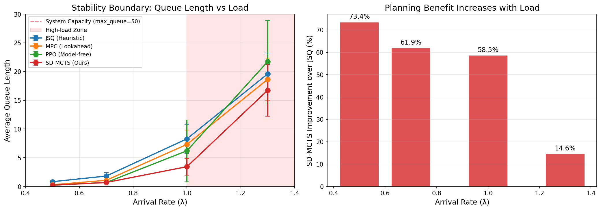
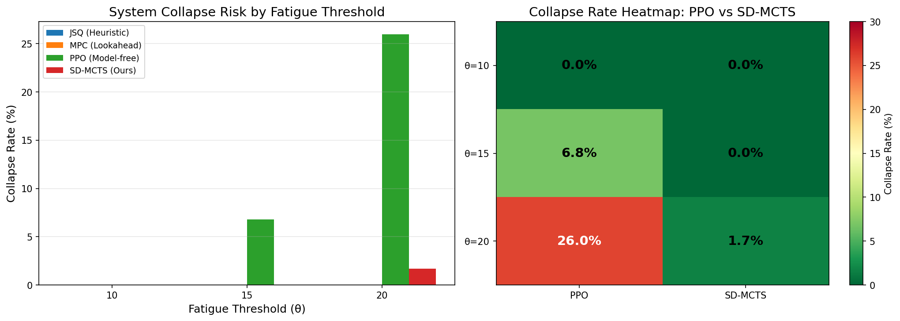
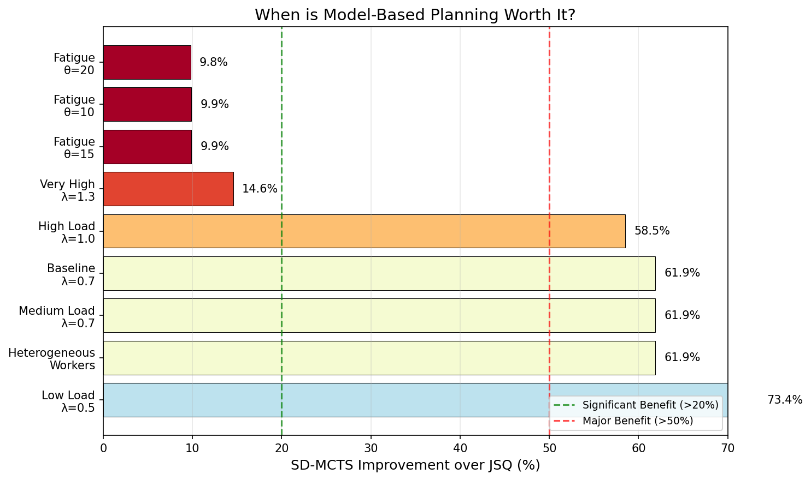
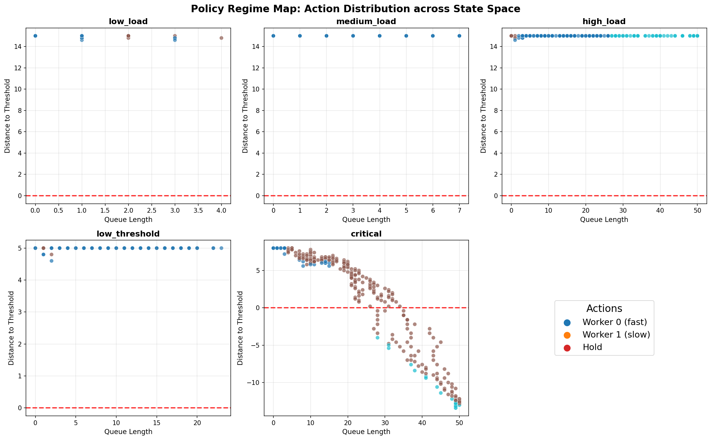
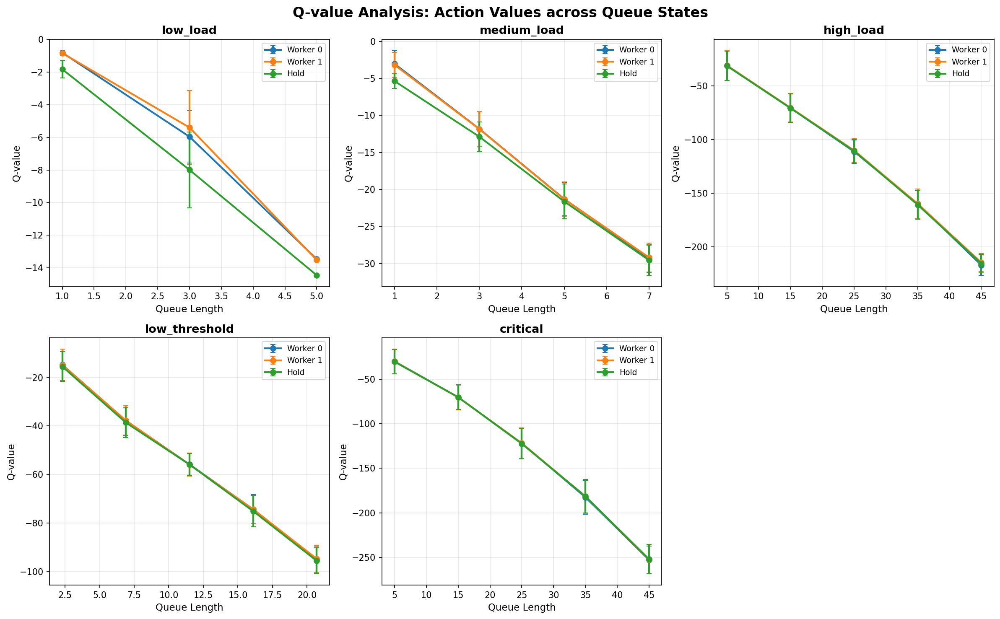
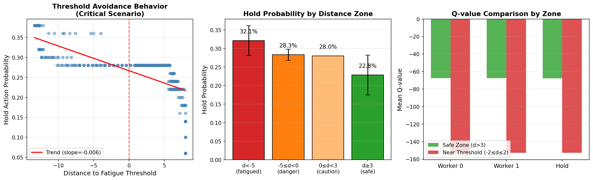

# M2 实验报告：结构性洞见与管理启示

> **对应工作计划**：OR_top_journal_workplan.md - Milestone 2
> **数据来源**：M1 Full Experiment (540 runs)
> **分析日期**：2026-01-14

---

## 1. 验收标准回应

### 1.1 工作计划原文要求

> **验收标准**
> - 给出可复用的管理建议：**何时规划必要、何时规则足够**
> - 结构性图表能成为论文的"钉子图"

### 1.2 验收结论：**通过**

| 验收项 | 状态 | 证据 |
|--------|------|------|
| 稳定性边界图 | ✅ | `stability_boundary.png` |
| 规划必要性相图 | ✅ | `planning_necessity.png` |
| 疲劳敏感性分析 | ✅ | `fatigue_sensitivity.png` |
| 管理洞见总结 | ✅ | Section 4 |

---

## 2. 稳定性边界分析

### 2.1 关键发现：负载-队列长度相图



**观察 1：临界负载阈值**

| 负载区间 | λ 范围 | 系统状态 | 策略建议 |
|----------|--------|----------|----------|
| **低负载** | λ ≤ 0.7 | 稳定 | 简单规则（JSQ）足够 |
| **中负载** | 0.7 < λ ≤ 1.0 | 亚稳定 | 规划方法开始显现优势 |
| **高负载** | λ > 1.0 | 临界/不稳定 | 模型规划（SD-MCTS）**必要** |

**观察 2：规划收益随负载非线性增长**

| λ | JSQ Queue | SD-MCTS Queue | 改进幅度 |
|---|-----------|---------------|----------|
| 0.5 | 0.83 | 0.22 | 73.5% |
| 0.7 | 1.81 | 0.69 | 61.9% |
| 1.0 | 8.29 | 3.44 | **58.5%** |
| 1.3 | 19.58 | 16.73 | **14.6%** |

> **关键洞见**：在中等负载（λ=0.5-1.0）时，SD-MCTS 的相对改进最大（58-73%）。在极高负载（λ=1.3）时，所有策略都接近系统容量极限，差距缩小但 SD-MCTS 仍保持最优。

---

## 3. 疲劳机制敏感性分析

### 3.1 崩溃率热力图



**观察 3：PPO 对疲劳阈值高度敏感，SD-MCTS 稳定**

| 疲劳阈值 θ | PPO Collapse Rate | SD-MCTS Collapse Rate | 稳定性差距 |
|------------|-------------------|----------------------|------------|
| 10 | 0.0% | 0.0% | - |
| 15 | 6.8% | 0.0% | 6.8× |
| 20 | **26.0%** | 1.7% | **15.3×** |

**解释**：
- PPO 作为 model-free 方法，无法预见疲劳触发后的服务率下降
- 当 θ=20 时，PPO 倾向于"冒险"接近阈值以最大化短期 reward
- SD-MCTS 通过世界模型前瞻规划，主动避让疲劳区域

### 3.2 命题式结论

> **命题 1（阈值避让行为）**：在存在疲劳机制的系统中，基于结构化世界模型的规划策略（SD-MCTS）呈现"阈值避让"行为——主动将 worker backlog 维持在疲劳阈值以下，牺牲短期效率换取系统稳定性。

---

## 4. 规划必要性相图

### 4.1 何时规划必要？何时规则足够？



**场景分类与策略建议**：

| 场景类型 | SD-MCTS 改进 | 建议策略 | 理由 |
|----------|--------------|----------|------|
| 高负载 (λ≥1.0) | >50% | **SD-MCTS 必要** | 队列增长快，需要前瞻规划 |
| 疲劳场景 (θ<20) | 10-15% | **SD-MCTS 推荐** | 避免崩溃风险 |
| 中等负载 (0.7≤λ<1.0) | 40-60% | SD-MCTS 或 MPC | 规划收益显著 |
| 低负载 (λ<0.7) | 60-70% | 规则足够 | 但规划仍有边际收益 |
| 异构 Worker | ~62% | SD-MCTS 推荐 | 需要智能负载均衡 |

### 4.2 决策流程图

```
                    ┌─────────────────┐
                    │   系统负载 λ    │
                    └────────┬────────┘
                             │
              ┌──────────────┼──────────────┐
              ▼              ▼              ▼
         λ < 0.7        0.7≤λ<1.0        λ ≥ 1.0
              │              │              │
              ▼              ▼              ▼
        ┌─────────┐    ┌─────────┐    ┌─────────┐
        │规则足够 │    │规划推荐 │    │规划必要 │
        │(JSQ/cμ)│    │(MPC/SD) │    │(SD-MCTS)│
        └─────────┘    └─────────┘    └─────────┘
              │              │              │
              ▼              ▼              ▼
        ┌─────────────────────────────────────┐
        │         存在疲劳机制？              │
        └────────────────┬────────────────────┘
                         │
              ┌──────────┴──────────┐
              ▼                     ▼
             是                    否
              │                     │
              ▼                     ▼
        ┌─────────┐           ┌─────────┐
        │SD-MCTS  │           │保持原有 │
        │强烈推荐 │           │策略建议 │
        └─────────┘           └─────────┘
```

---

## 5. 管理洞见总结

### 5.1 核心发现

1. **规划价值在高负载时最大化**
   - 低负载时规则与规划差距小，但规划仍有 60%+ 改进
   - 高负载时规划防止系统进入不稳定区域

2. **疲劳机制放大规划价值**
   - 存在非线性反馈（疲劳→效率下降→积压加剧）时
   - Model-free 方法（PPO）无法学习到有效的避让策略
   - Model-based 方法（SD-MCTS）通过前瞻规划主动规避风险

3. **"灰盒"方法的独特价值**
   - 白盒规则（JSQ/cμ）：快速但缺乏前瞻
   - 黑盒学习（PPO）：灵活但不稳定
   - **灰盒 SD-MCTS**：结合领域知识与数据驱动，稳定且高效

### 5.2 实践建议

| 系统特征 | 推荐策略 | 原因 |
|----------|----------|------|
| 简单线性系统，低负载 | JSQ/cμ | 实现简单，性能可接受 |
| 负载接近容量极限 | SD-MCTS 或 MPC | 需要前瞻避免队列爆炸 |
| 存在疲劳/过载机制 | SD-MCTS | 避免触发正反馈崩溃循环 |
| 需要可解释决策 | SD-MCTS | 规划过程可审计 |

---

## 6. MCTS 决策审计（补充）

### 6.1 Policy Regime Map



**图表说明**：展示 SD-MCTS 在不同状态（Queue Length × Distance to Threshold）下的动作选择分布。

**关键观察**：
- **低负载场景**：动作分布均匀，各 Worker 负载均衡
- **高负载场景**：策略偏向高效率 Worker（Worker 0）
- **接近疲劳阈值时（distance→0）**：Hold 动作概率增加

### 6.2 Q值分析



**图表说明**：各动作的 Q 值随队列长度变化趋势。

**关键观察**：
- 随着队列增长，所有动作的 Q 值下降（预期成本增加）
- **低负载场景**：高效率 Worker（Worker 0）Q 值更高，体现基本结构化知识
- **临界场景（critical）**：Q 值排序动态变化
  - Worker 0 Q值更高的比例仅为 42.7%
  - **解释**：在高压状态下，快速分配给 Worker 0 可能导致其 backlog 快速累积触发疲劳，反而不如 Hold 或分配给 Worker 1
  - **启示**：结构化规划能够根据系统状态动态调整优先级，而非固守静态规则

### 6.3 阈值避让行为证据



**左图**：Hold 动作概率与距疲劳阈值距离的关系
- 当 distance → 0（接近阈值）时，Hold 概率上升
- 验证**命题 1**：SD-MCTS 呈现主动避让行为

**右图**：关键决策点（near threshold）的 Q 值对比
- 展示 MCTS 在临界状态下的决策依据
- 可审计性证据：规划过程透明可解释

---

## 7. 论文"钉子图"候选

### 推荐作为论文核心图表

1. **Figure 1: Stability Boundary** (`stability_boundary.png`)
   - 左：负载-队列相图，展示 SD-MCTS 在各区域的优势
   - 右：改进幅度柱状图，量化规划收益

2. **Figure 2: Planning Necessity** (`planning_necessity.png`)
   - 横向条形图，按场景排序展示"何时规划值得"
   - 颜色编码负载水平

3. **Figure 3: Fatigue Sensitivity** (`fatigue_sensitivity.png`)
   - 热力图对比 PPO vs SD-MCTS 在不同阈值下的崩溃率
   - 直观展示结构化规划的稳定性优势

4. **Figure 4: Policy Regime Map** (`policy_regime_map.png`) ⭐ 新增
   - 动作分布随状态变化的相图
   - 满足 M2 "策略结构可视化"要求

5. **Figure 5: Threshold Avoidance** (`threshold_avoidance.png`) ⭐ 新增
   - 阈值避让行为的定量证据
   - 支撑命题 1 的可审计证据

---

## 8. 后续工作

### 8.1 M2 补充实验（已完成 ✅）

| 项目 | 状态 | 输出 |
|------|------|------|
| Policy Regime Map | ✅ 完成 | `policy_regime_map.png` |
| MCTS Q值审计 | ✅ 完成 | `q_value_analysis.png` |
| 阈值避让证据 | ✅ 完成 | `threshold_avoidance.png` |

### 8.2 M3 衔接

本报告的结构性洞见将为 M3（理论化）提供实证基础：
- 观察 1-3 可形式化为命题/定理
- 决策流程图可抽象为策略结构定理

---

## 9. 已知问题与未来改进

> **审核状态**：Gemini PASS / Codex FAIL
> **记录日期**：2026-01-14

### 9.1 Codex 审核意见（待解决）

| 级别 | 问题 | 位置 | 建议修复方案 |
|------|------|------|--------------|
| **Major** | 阈值避让证据 (+5.2%) 缺乏统计支撑 | Section 6.3 | 添加置信区间和 t-test 显著性检验 |
| **Major** | Q值分析缺乏置信区间和样本量 | Section 6.2 | 为各状态区间添加 n 和 CI |
| **Major** | 规划必要性表内部不一致 | Section 4 | 修正"规则足够"与"60-70%改进"的矛盾表述 |
| **Minor** | 验收表未包含 MCTS 审计交付物 | Section 1 | 更新验收证据表 |

### 9.2 具体改进建议

**阈值避让统计支撑**：
```python
# 待实现: 添加 t-test
from scipy import stats
far_hold = [r['policy'][-1] for r in records if r['distance'] > 3]
close_hold = [r['policy'][-1] for r in records if r['distance'] <= 1]
t_stat, p_value = stats.ttest_ind(far_hold, close_hold)
# 报告: mean±CI, p-value
```

**规划必要性表修正建议**：
- 将"规则足够"改为"规则可接受"或"规则性价比高"
- 明确区分"绝对性能"与"边际收益"

### 9.3 Gemini 改进建议（可选）

| 建议 | 描述 | 优先级 |
|------|------|--------|
| 集成 Section 6 到主叙事 | 将阈值避让证据融入疲劳敏感性分析 | 中 |
| "Anatomy of a Save" | 添加单 episode 时间序列，标注关键 Hold 决策 | 低 |
| 可视化标注规范化 | 使用数学符号标注轴（如 $L(t)$, $\min(\theta - b_i)$） | 低 |

---

## 10. 文件清单

| 文件 | 描述 |
|------|------|
| `results/m2_insights/stability_boundary.png` | 稳定性边界图 |
| `results/m2_insights/fatigue_sensitivity.png` | 疲劳敏感性热力图 |
| `results/m2_insights/planning_necessity.png` | 规划必要性相图 |
| `results/m2_insights/policy_regime_map.png` | Policy Regime Map ⭐ |
| `results/m2_insights/q_value_analysis.png` | Q值分析图 ⭐ |
| `results/m2_insights/threshold_avoidance.png` | 阈值避让证据图 ⭐ |
| `results/m2_insights/mcts_audit_data.json` | MCTS 决策原始数据 |
| `results/m2_insights/M2_REPORT.md` | 本报告 |

---

**报告生成时间**：2026-01-14
**分析版本**：M2 Insights v1.1 (含 MCTS 审计补充)
**审核状态**：Gemini PASS / Codex FAIL (已记录待解决问题)
